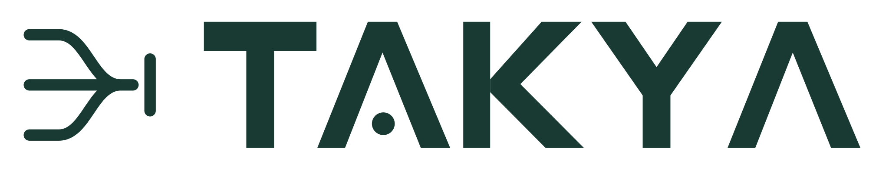
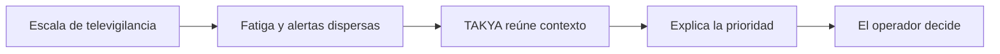

<p align="center">
  
</p>

# TAKYA · Comprender antes de actuar

> **Versión estable v3.0.1 · 22 de octubre de 2026 · publicada en [takya.cl](https://takya.cl).** Landing pública sin acceso a la demo; home del software con login privado (usuario fijo `centinela` y contraseña del equipo validada en el servidor); consola en Liquid Glass con un solo flujo de decisión: **Observar → Comprender → Decidir → Proteger**. La memoria completa del software está en [ENGRAM.md](ENGRAM.md).
>
> **Validación en terreno:** [visita PDI y policías](docs/validacion/VISITA_PDI_POLICIAS.md) · [hallazgos de la central municipal, contactos de evidencia digital y decisiones de acceso](docs/estrategia/14_VALIDACION_EN_TERRENO.md).

Vitrina digital de TAKYA, una propuesta de apoyo a operadores de televigilancia mediante contexto y prioridades explicables. Proyecto desarrollado para el Programa Nómada UCN en Antofagasta.

> **Qué es real y qué es simulado:** las señales en vivo y el análisis se simulan con videos ya cargados (sin subir archivos, pensado para iPad); la protección de la evidencia es criptografía real en el navegador (huella SHA-256, firma Ed25519, cifrado AES-256-GCM, verificación y prueba de alteración). No hay cámaras en vivo ni despacho real. `/demo?mode=analysis&motor=local` conserva el análisis de archivo con el backend local (ver más abajo).

## Navegación rápida

[Ver la landing](#ver-la-v1) · [Probar la consola](#probar-la-consola) · [Iniciar en local](#iniciar-en-local) · [Entender el proyecto](#qué-muestra-la-landing) · [Mapa técnico](#mapa-técnico) · [Antes de compartir](#antes-de-compartir) · [Documentación](#documentación-del-equipo)

## Ver la V1

- **Entrada local:** `/` redirige a `/home`; `/landing` presenta el proyecto.
- **Contenido:** problema de la fatiga cognitiva, propuesta de TAKYA y criterio humano en la decisión.
- **Repositorio:** [Delnr91/takya](https://github.com/Delnr91/takya).

| Ruta                       | Acceso   | Para qué sirve                                                            |
| -------------------------- | -------- | ------------------------------------------------------------------------- |
| `/`                        | Pública  | Abre `/home`.                                                             |
| `/home`                    | Pública  | Entrada audiovisual: «Conocer el Proyecto» y «Consola Interactiva».       |
| `/landing`                 | Pública  | Presentación del proyecto, sin botones a la demo (se muestra en persona). |
| `/login`                   | Pública  | Home del software: bienvenida y acceso privado (día/noche).               |
| `/demo`                    | Privada  | Consola del operador. Sin la cookie de acceso vuelve a `/login`.          |
| `/api/k8`, `/api/analysis` | Privadas | Responden 401 sin acceso.                                                 |

## Qué muestra la landing



El relato usa las cifras de contexto de la documentación interna: **130 cámaras** en el sistema municipal de Antofagasta, **1.245 cámaras** como proyección regional y **50 %** como referencia citada sobre eventos no detectados por fatiga visual. La proyección no describe una red operativa actual y ninguna cifra representa un resultado medido por TAKYA.

<details>
<summary><strong>Recorrido sugerido para presentar la V1</strong></summary>

1. Abre `/landing` y explica la idea: **comprender antes de actuar**.
2. Baja a **El problema** para hablar de escala y carga de atención.
3. Muestra **La propuesta**: detectar, agrupar, explicar, verificar y registrar.
4. Cierra con **Nuestro criterio**: la tecnología orienta y la persona decide.

</details>

## Probar la consola

Desde `/home`, pulsa **Consola Interactiva**. En `/login` el usuario es fijo (`centinela`); escribe la contraseña del equipo (pídela al equipo; no se guarda en el repositorio) y pulsa **Iniciar sesión**. El candado se cierra y abre la consola. El modo día/noche del login se comparte con la consola.

<details>
<summary><strong>Recorrido para presentar (6 a 8 minutos)</strong></summary>

1. **Inicio:** el próximo caso, su video y el recorrido «Cámara → Grabación → TAKYA → Evidencia».
2. **Analizar → En vivo → Cámara 07:** TAKYA revisa la señal y no encuentra nada (queda **descartado** en el historial).
3. **Empezar de nuevo → En vivo → Cámara 12:** detecta una descarga de residuos y muestra **lo que vio** y **lo que no sabe**. Pulsa **Revisar el caso**.
4. El caso abre en la revisión, igual que cualquier caso de **Casos**: **Observar** (revisa cada clip) → **Comprender** → **Decidir** (Verificar, Derivar o Descartar, con motivo y destino; se puede volver) → **Proteger**.
5. **Proteger evidencia:** el candado sella paso a paso (huella, firma, cifrado). Luego **Verificar integridad** (íntegra) y **Probar una alteración** (cambia un byte y TAKYA lo detecta). **Descargar paquete** y **Descargar clave** van por canales distintos.
6. **Historial:** quién revisó, qué decidió y por qué, con la evidencia sellada.
7. **K8 IA:** voz primero («Hablar»), fichas de preguntas y respuestas en lectura fácil.

En **Ajustes** se cambia lectura, ritmo de llegadas, modo noche, se reinicia la práctica o se cierra sesión (también borra el acceso del servidor).

</details>

Los nuevos ejercicios usan registros grabados de fuego, residuos y un camión sin descarga visible. La llegada de avisos y la recepción por Supervisión son simuladas; ninguna decisión despacha recursos. Las señales y sugerencias están curadas: K8 no recibe videos ni ve el caso abierto. Las sesiones ilustradas anteriores se conservan hasta reiniciar con confirmación. **Ocultar ayuda lateral** amplía el visor; **Ocultar K8** retira la mascota. Movimiento reducido, texto grande, alto contraste y paneles sólidos ayudan a adaptar la lectura. Consulta el [recorrido funcional](docs/06_DEMO_OPERATOR_FLOW.md), el [registro de edición de videos](docs/media/README.md) y la [decisión de arquitectura](docs/adr/0005-recorded-evidence-and-cognitive-motion.md).

<details>
<summary><strong>Configurar el chat sin exponer claves</strong></summary>

Configura `GROQ_API_KEY` en `.env.local` y en las variables privadas del servidor de Vercel (proyecto **takya-app** del equipo **incluyemes-projects**). Nunca uses el prefijo `NEXT_PUBLIC_` ni subas una clave a Git. `.env*` está excluido del repositorio. Sin la variable, el chat explica que no puede responder y conserva la pregunta.

La ruta valida origen, formato, longitud y orden de mensajes, limita solicitudes y redirige temas ajenos antes del proveedor. Los intentos rechazados y patrones de claves no se reenvían en el historial. Estos filtros reducen abuso conocido; no sustituyen autenticación ni límites distribuidos para una plataforma operativa.

</details>

Para la siguiente etapa, consulta las [opciones de arquitectura IA-first](docs/07_ARQUITECTURA_IA_FIRST.md) y la [revisión de seguridad](docs/08_REVISION_SEGURIDAD.md). El camino recomendado es un sistema híbrido: detectar eventos cerca de la fuente, reunirlos en casos y producir explicaciones verificables desde un servicio protegido.

## Iniciar en local

Requisitos: Node.js **20.9 o posterior** y npm. Verificado en este equipo con Node.js 22.23.3 y npm 10.9.9; `.nvmrc` selecciona la rama 22 si usas nvm. Desde la raíz del repositorio:

```bash
npm ci
npm run dev
```

Abre [http://127.0.0.1:3000](http://127.0.0.1:3000). La redirección te llevará a `/home`. Para probar la consola directamente, abre [el acceso de práctica](http://127.0.0.1:3000/login), elige Operador y pulsa **Entrar a la práctica**. El servidor de desarrollo escucha solo en este equipo y actualiza los cambios automáticamente; se detiene con `Ctrl+C`.

No necesitas variables de entorno para usar casos, videos, decisiones, supervisión, historial ni **Guíame** de K8. Las consultas libres a Groq sí requieren una clave privada: copia `.env.example` a `.env.local`, completa `GROQ_API_KEY` y reinicia el servidor. Sin clave, el chat conserva la pregunta y muestra un aviso de indisponibilidad. La instalación y la primera compilación necesitan internet, incluida la descarga de tipografías.

Para usar una compilación de producción local, ejecuta `npm run build` y después `npm run start:local`, con el servidor de desarrollo detenido. Ambos modos usan el puerto 3000; si ya está ocupado, puedes iniciar desarrollo con `npm run dev -- --port 3001`.

### Analizar archivo (backend local)

El modo `/demo?mode=analysis` necesita un segundo proceso: el backend Python (FastAPI + worker aislado), que solo escucha en `127.0.0.1:8765`. Requisitos: Python 3.12, FFmpeg/ffprobe, `bwrap` y `prlimit` (Linux).

```bash
python3 -m venv backend/.venv
```

```bash
backend/.venv/bin/pip install -r backend/requirements.lock
```

Si tu Python no trae `pip`/`ensurepip`, crea el entorno con `--without-pip` e instala con [pip.pyz](https://bootstrap.pypa.io/pip/pip.pyz). Descarga el detector según [backend/MODEL.md](backend/MODEL.md) y verifica su SHA-256. Luego, en una terminal aparte:

```bash
npm run analysis:serve
```

Con `npm run dev` en otra terminal, abre `/demo` y elige **Analizar archivo**. Sin el backend, ese modo muestra «El análisis local no está disponible» y la práctica sigue funcionando. Pruebas del backend: `npm run analysis:test`. Diseño y límites: [plan maestro de la demo](docs/maestros/PLAN_MAESTRO_DEMO_FINAL.md) y [documento maestro](docs/maestros/DOCUMENTO_MAESTRO_TAKYA_E2E.md).

El [diagnóstico local](docs/10_ESTADO_LOCAL.md) explica la arquitectura, las verificaciones de esta descarga y el punto de partida para construir el backend de casos.

<details>
<summary><strong>Comandos de verificación</strong></summary>

```bash
npm run typecheck
npm run lint
npm run test:demo
npm run format:check
npm run build
```

`npm run build` genera la misma compilación de producción que utiliza Vercel. Si alguna comprobación falla, revisa el resultado antes de publicar nuevos cambios.

En la puesta en marcha local del 18 de octubre de 2026 pasaron TypeScript, ESLint, 31 pruebas del dominio/chat y la compilación de producción. No se configuró ni comprobó una llamada real a Groq en esta máquina. La evidencia actual y los límites están en el [diagnóstico local](docs/10_ESTADO_LOCAL.md); [ENGRAM.md](ENGRAM.md) conserva también verificaciones históricas de otras entregas. El comando global `format:check` informa observaciones heredadas en cinco archivos; el código modificado en esta puesta en marcha cumple Prettier.

</details>

## Mapa técnico

| Lugar                                            | Contenido                                                        |
| ------------------------------------------------ | ---------------------------------------------------------------- |
| [`src/app/`](src/app/)                           | Rutas, layout, fuentes y estilos globales de Next.js App Router. |
| [`src/features/landing/`](src/features/landing/) | Componentes y movimiento de la página pública.                   |
| [`src/features/home/`](src/features/home/)       | Entrada audiovisual existente.                                   |
| [`src/features/demo/`](src/features/demo/)       | Motor local, práctica guiada, roles e historial de la consola.   |
| [`public/brand/`](public/brand/)                 | Logotipos, iconos y poster de marca.                             |
| [`public/referencias/`](public/referencias/)     | Referencias visuales del equipo.                                 |
| [`docs/`](docs/)                                 | Producto, arquitectura, diseño y plan maestro.                   |

**Stack:** Next.js App Router, React, TypeScript estricto, Tailwind CSS y Framer Motion. La landing no requiere variables de entorno ni servicios externos para funcionar.

<details>
<summary><strong>Despliegue manual en Vercel</strong></summary>

1. En Vercel, crea un proyecto e importa [Delnr91/takya](https://github.com/Delnr91/takya).
2. Selecciona la rama `main` y deja la **raíz del proyecto** en `/`.
3. Comprueba que Vercel detecte **Next.js** y use `npm run build`.
4. Variables de **Production**: `TAKYA_DEMO_PASSWORD_HASH` y `TAKYA_ACCESS_SECRET` (genéralas con `TAKYA_PASSWORD='…' node scripts/access/hash-password.mjs <archivo-privado>`; sin ellas la demo queda cerrada) y, opcional, `GROQ_API_KEY`. Si `/api/access` responde 503, su campo `diagnostico` indica qué variable falta o está mal formada, sin mostrar valores.
5. Despliega y revisa `/`, `/landing`, `/home`, `/login` y `/demo` en escritorio y móvil. La raíz abre `/home`; la presentación está en `/landing` y el acceso a la consola empieza en `/login`.

Si intentaste desplegar antes de recibir el nuevo commit en `main`, vuelve a ejecutar el despliegue desde ese commit y mira el final de **Build Logs** si Vercel informa otro error.

Si conectas GitHub al proyecto de Vercel, los cambios posteriores en `main` podrán generar nuevos despliegues automáticamente.

</details>

## Antes de compartir

- Presenta la consola como **demostración funcional con evidencia grabada**. El flujo se puede completar; las llegadas y la coordinación son simuladas y no hay conexión a CCTV.
- Las cifras de contexto provienen de documentos del proyecto; evita describirlas como resultados de TAKYA.
- El botón de WhatsApp de la versión actual usa un **número de ejemplo**. El equipo debe reemplazarlo por un canal real antes de utilizarlo como contacto comercial.
- La landing es pública; la demo es privada y se presenta en persona o con un acceso autorizado. El acceso de la demo es una puerta de práctica (usuario fijo y una contraseña de equipo), no un sistema de cuentas.

## Documentación del equipo

- [PRD: alcance y rutas](docs/01_PRD_TAKYA.md)
- [Arquitectura y reglas técnicas](docs/02_ARCHITECTURE_TRD.md)
- [Sistema de diseño](docs/03_DESIGN_SYSTEM.md)
- [Identidad visual](docs/05_IDENTIDAD_VISUAL_PPT_A.md)
- [Plan maestro](docs/maestros/PLAN_MAESTRO_CONSTRUCCION_TAKYA.md)
- [Recorrido de la consola](docs/06_DEMO_OPERATOR_FLOW.md)
- [Arquitectura IA-first](docs/07_ARQUITECTURA_IA_FIRST.md)
- [Revisión de seguridad](docs/08_REVISION_SEGURIDAD.md)
- [ENGRAM: estado de construcción](ENGRAM.md)

---

**Criterio de trabajo:** cambios pequeños, TypeScript sin `any`, componentes por feature y decisiones documentadas en `ENGRAM.md`.
