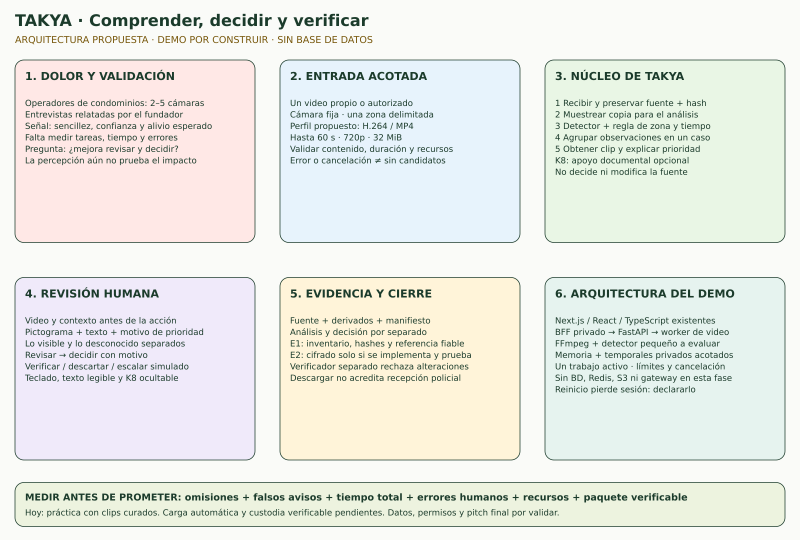
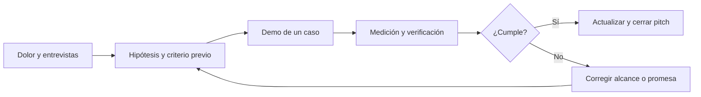

# TAKYA · Dossier maestro para construir y defender el demo

Fecha de corte: **18 de octubre de 2026**. Entrega documental y skills de proyecto. Versión 1.

**Decisión:** completar un caso de revisión retrospectiva: video autorizado → candidato de ingreso a zona restringida → revisión pictográfica → decisión humana → exportación verificable. Conservar la interfaz existente y construir el procesamiento por etapas, sin base de datos.

**Estado del pitch final: pendiente de validación.** La consola de práctica existe; la carga y el análisis automático de un archivo nuevo, la protección integral de evidencia y las mediciones comparativas todavía no están implementados. Este dossier permite construirlos y preparar el relato. No declara el demo objetivo terminado.

[Abrir el mapa inicial](diagramas/takya-demo-sin-bd.svg) · [Excalidraw inicial](diagramas/takya-demo-sin-bd.excalidraw).

**Mapa completo solicitado:** [imagen PNG](diagramas/takya-logica-completa.png) · [SVG ampliable](diagramas/takya-logica-completa.svg) · [Excalidraw editable](diagramas/takya-logica-completa.excalidraw). Incluye recorrido de inicio a salida, backend, frontend, librerías, arquitectura, patrones, seguridad y UI/UX. El backend se marca como propuesto.

**Decisión de costo y cifrado:** procesamiento y cifrado locales, sin nube obligatoria ni Amazon/S3 contratados. Ver el documento 11 para claves, custodia futura, leyes y ODS.

## Leer por decisión

| Documento | Resuelve |
| --- | --- |
| [01 · Documento maestro](01_DOCUMENTO_MAESTRO.md) | SCQA, árbol MECE, 80/20, hipótesis refutables, zona de datos, negocio y relato para jueces |
| [02 · Backend y datos](02_BACKEND_DATOS_ARQUITECTURA.md) | Stack, módulos, contratos, API propuesta, procesamiento y operación efímera |
| [03 · Evidencia y seguridad](03_EVIDENCIA_SEGURIDAD_TESTS.md) | Sello verificable, límites de confianza, Zero Trust, pruebas desde el primer incremento |
| [04 · K8 e IA](04_K8_ESTRATEGIA_IA.md) | Detector, reglas, recuperación documental, LLM, abstención y evaluaciones |
| [05 · Roles y demo](05_PLAN_ROLES_Y_DEMO.md) | Responsabilidades, orden de ejecución, aceptación, ensayo y cierre del pitch |
| [06 · Criterio del CEO](06_CEO_CRITERIO.md) | Foco, diferenciación, ventas, aprendizaje y decisiones reversibles |
| [07 · Criterio del CTO](07_CTO_CRITERIO.md) | Módulos profundos, costuras de datos, monolito modular y rigor verificable |
| [08 · Prompt y skills](08_SYSTEM_PROMPT_Y_SKILLS.md) | Agente constructor y comité que cuestiona decisiones |
| [09 · Fuentes y auditoría](09_FUENTES_Y_AUDITORIA.md) | Investigación revisada, correcciones, fuentes externas y verificaciones de esta entrega |
| [10 · Seminario PDI](10_APRENDIZAJES_SEMINARIO_PDI.md) | Aplicaciones del material educativo, minutos de consulta y límites del análisis audiovisual |
| [11 · Decisión de cifrado local](11_DECISION_CIFRADO_LOCAL_LEYES_ODS.md) | Procesamiento elegido, protección local, almacenamiento de bajo costo, leyes y ODS |

## Qué cambia respecto de los planes anteriores

Este dossier registra el **alcance solicitado para el próximo demo**. Ante diferencias de propuesta técnica, usar esta secuencia y mantener las restricciones de seguridad de los documentos anteriores. No reemplaza instrucciones AGENTS ni convierte propuestas en capacidades implementadas.

- El siguiente incremento de [10_ESTADO_LOCAL](../10_ESTADO_LOCAL.md) sugería persistencia/API de casos. Ahora se prioriza **procesamiento de archivos sin BD**, con estado efímero explícito.
- PostgreSQL/PostGIS, S3/MinIO y Redis del dibujo original son opciones de investigación, no decisiones adoptadas; no se instalan para esta fase. Tampoco SQLite. La custodia futura se plantea primero local y cifrada.
- Las rutas y componentes de TAKYA existentes se reutilizan. No se vuelve a crear la aplicación ni se migra el stack.
- Las métricas de simulación y la historia municipal de los documentos anteriores no son resultados del nuevo procesamiento ni describen a los operadores entrevistados en condominios.
- El historial del navegador sigue siendo una práctica manipulable. El nuevo flujo requiere estados y decisiones del servidor, aun sin BD.

## Regla de lectura

**Observado** = inspeccionado o ejecutado en esta sesión. **Reportado** = relato del fundador o documentación previa. **Propuesto** = decisión de diseño aún por construir. **Meta** = umbral de experimento, nunca resultado.

No completar campos desconocidos con cifras plausibles. Fecha/duración del pitch, pauta de jueces, número de entrevistados, autorizaciones de video, presupuesto y responsables nominales siguen pendientes si el equipo no los aporta.

## Mapa de entrega

El cierre del pitch depende de las puertas de aceptación del documento 05. Un checklist redactado no equivale a un checklist aprobado.
