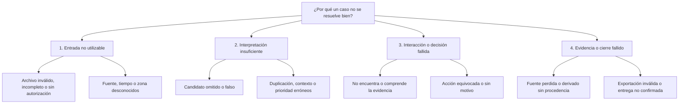

# TAKYA · Documento maestro de producto y pitch

Estado: **base consolidada para validación; pitch final aún no liberado**. Corte: 18-10-2026.

[Índice del dossier](00_INDICE_Y_ESTADO.md) · [Plan de construcción](05_PLAN_ROLES_Y_DEMO.md)

## 1. Conclusión que guía el trabajo

**TAKYA ayuda al operador a comprender un incidente y decidir con evidencia verificable.** Convierte señales en casos explicados, presenta el contexto con pictogramas y texto breve y registra la decisión humana. El prototipo objetivo demostrará esa secuencia cargando un video autorizado, sin BD y con archivos temporales controlados.

La apuesta comercial es **claridad operativa más protección comprobable de evidencia**. La velocidad y el menor consumo de recursos deben medirse junto con lo que el detector omite. Tener un LLM o un detector disponible no constituye una ventaja sostenible por sí mismo.

## 2. SCQA: formular el dolor antes de vender la solución

| Parte | Formulación para TAKYA | Evidencia y límite |
| --- | --- | --- |
| Situación | Operadores de seguridad privada en condominios observan entre 2 y 5 cámaras, según entrevistas relatadas por el fundador. | Reportado; faltan muestra, fecha, tareas y notas originales. No confundir con 130 cámaras municipales. |
| Complicación | Deben entender qué merece atención, revisar contexto y decidir qué hacer. Una consola difícil o una exportación confusa podría aumentar su esfuerzo e incertidumbre. | Problema propuesto para observar; su frecuencia y costo todavía no están medidos. |
| Pregunta | ¿Podemos ayudarles a revisar y resolver un caso con menos esfuerzo y errores, conservando una relación verificable con el video recibido? | Pregunta de validación del demo. |
| Respuesta | Separar preservación y análisis; generar candidatos con reglas explícitas; mostrar evidencia y explicación antes de pedir una decisión. | Hipótesis de producto. Comparar contra revisión manual y medir. |

**Dolor prioritario:** incertidumbre y esfuerzo al revisar un caso y elegir el siguiente paso. El número de cámaras por sí solo no prueba sobrecarga; con 2–5 cámaras puede haber multitarea, interrupciones o problemas de exportación que hay que observar.

## 3. Entrevista: qué sabemos y qué no

El fundador relata que operadores de condominios encontraron la herramienta fácil de entender y usar; una persona comentó que parecía algo para niños. También describieron potencial de seguridad, confianza y alivio en su trabajo diario. Este párrafo es **paráfrasis del relato recibido**, no transcripción ni cita autorizada para publicidad.

| Señal | Interpretación provisional | Próxima prueba |
| --- | --- | --- |
| Fácil de entender | Puede haber baja barrera de aprendizaje. | Completar tareas sin explicación del fundador. |
| Apariencia infantil | Puede expresar sencillez o pérdida de seriedad. | Comparar dos presentaciones con el mismo flujo; preguntar sin sugerir la respuesta. |
| Confianza y alivio esperados | Existe una expectativa de ayuda. | Observar uso, errores y confianza calibrada frente a un fallo deliberado. |
| Uso de un recurso de apoyo | K8 puede ayudar a encontrar el siguiente paso. | Comparar con ayuda fija; comprobar que no decide por el operador. |

No inferir edad, escolaridad, alfabetización digital ni fatiga clínica. No afirmar que hay clientes, contratos, adopción, seguridad mejorada o reducción de incidentes por estas opiniones.

## 4. Árbol MECE: dónde se pierde valor en el recorrido

La partición usa **el punto del flujo en que ocurre el fallo**. Una causa transversal se referencia en varios puntos, pero un incidente de fallo se contabiliza una vez por su origen. Así se evita sumar dos veces el mismo retraso. El árbol es exhaustivo para este recorrido acotado, no para toda la seguridad física.

Ejemplo: una espera causada por un video corrupto pertenece a entrada; una espera por no entender el botón pertenece a interacción. El tiempo total se mide de extremo a extremo sin sumar métricas que se superponen. Seguridad, rendimiento y costo son restricciones transversales y tienen responsables propios.

## 5. Elegir la rama que mueve el resultado: 80/20

**Prioridad de valor: rama 3, revisar y decidir. Dependencias obligatorias: entrada válida y protección de la fuente.** Primero construir el recorrido completo más pequeño; después optimizar el detector. Las puntuaciones siguientes son juicio de planificación, no un estudio cuantitativo.

Escalas 1–5; esfuerzo relativo en días-persona propuestos. Orden: primero seguridad imprescindible; luego impacto × confianza / esfuerzo. Confianza es una estimación explícita del equipo.

| Trabajo | Impacto | Confianza | Esfuerzo | Puntaje orientativo | Decisión |
| --- | ---: | ---: | ---: | ---: | --- |
| Evidencia visible, pasos claros y decisión con motivo | 5 | 0,7 | 2 | 1,75 | Primera capacidad de valor; reutilizar UI |
| Carga acotada, fuente intacta y verificador | 5 | 0,8 | 3 | 1,33 | Prerrequisito de seguridad; no compite por puntaje |
| Detector y regla para una zona | 5 | 0,5 | 4 | 0,63 | Necesario para el demo automático |
| Medición comparativa reproducible | 4 | 0,8 | 2 | 1,60 | Necesaria antes de afirmar mejora |
| K8 conectado al contexto validado | 3 | 0,5 | 2 | 0,75 | Después de completar el flujo sin K8 |
| Nuevo diseño 3D o animaciones | 1 | 0,6 | 3 | 0,20 | Posponer |
| Varios tipos de incidente y cámaras en vivo | 4 | 0,3 | 10 | 0,12 | Posterior al primer experimento |

## 6. Hipótesis primero: qué nos probaría equivocados

Umbrales de abajo son **metas iniciales propuestas para el ensayo**, a ratificar antes de medir. No son resultados ni tolerancias de un sistema operativo crítico.

| ID | Hipótesis | Experimento mínimo | Refutación o condición de revisión |
| --- | --- | --- | --- |
| H1 | El flujo guiado mejora la revisión. | Tareas equivalentes, orden contrabalanceado, mismo material. | No mejora al menos 20% la mediana de tiempo o aumenta errores. Una mejora de tiempo con más omisiones no cuenta. |
| H2 | La simplificación mantiene dignidad y comprensión. | 5 operadores iniciales completan revisar, decidir y reconocer un fallo; observar sin guiar. | Menos de 4/5 completan o la apariencia reduce confianza/interpretación. Muestra exploratoria. |
| H3 | Muestrear reduce trabajo sin deteriorar demasiado detección. | Referencia de mayor FPS frente a 1/2 FPS; conjunto separado y anotado. | Pierde más de 5 puntos porcentuales de recall o suben falsas alertas; revisar muestreo/regla. |
| H4 | Proteger evidencia aporta valor. | Verificación de paquete y entrevista con comprador tras realizar la tarea. | No valoran la tarea, no hay responsable ni compromiso verificable de piloto. |
| H5 | K8 añade ayuda útil. | Comparar ayuda fija y K8; incluir preguntas sin respuesta y caída de red. | Inventa hechos, induce una acción riesgosa o no mejora finalización/ayuda requerida. |
| H6 | El segmento paga por resolver el trabajo. | Entrevista con comprador, oferta acotada y costo estimado. | Tres compradores calificados no aceptan explorar un piloto con alcance y precio. No es prueba definitiva del mercado. |

Documentar resultados que contradigan la hipótesis y casos excluidos. Si la muestra no permite concluir, registrar **inconcluso**. Cambiar el umbral después de ver el resultado exige un experimento nuevo.

## 7. Zona de datos: decisión → dato → fuente → plan mínimo

| Decisión | Dato necesario | Fuente | Plan mínimo viable | Dueño / estado |
| --- | --- | --- | --- | --- |
| Elegir dolor y segmento | Tarea, interrupciones, frecuencia y consecuencia del problema | Operadores y observación autorizada | Recuperar notas; 5 sesiones exploratorias de tarea, sin grabar datos personales innecesarios | Producto / pendiente |
| Elegir caso inicial | Definición observable, zona y ejemplos positivos/negativos | Video propio/autorizado y dos anotadores | 10 positivos y 10 negativos para smoke test; no se anuncian métricas de fiabilidad | Data / pendiente |
| Elegir detector y FPS | Recall por evento, FP/h, tiempo y memoria | Ensayo local reproducible | Comparar dos configuraciones; separar videos de ajuste y evaluación; ampliar al menos a 50 positivos y 50 negativos si se quieren métricas preliminares | ML / pendiente |
| Afirmar rapidez | Tiempo de carga, cola, análisis, presentación y tarea humana | Relojes monotónicos y prueba UX | Registrar cada etapa; repeticiones frías/calientes; informar n y dispersión | QA / pendiente |
| Afirmar eficiencia | Cuadros inferidos, bytes derivados, tiempo total y RAM pico | Instrumentación del worker | Mismos archivos, hardware y versión; contar también fallos | Data + plataforma / pendiente |
| Afirmar protección | Hashes, inventario, fallo ante manipulación y política de clave | Verificador independiente | Paquete correcto, bit alterado, archivo faltante, clave incorrecta y manifiesto modificado | Seguridad / pendiente |
| Elegir precio | Costo por sitio/mes y disposición a pagar | Comprador + mediciones de operación | 3 entrevistas comerciales; cotización fechada por carga definida | CEO / pendiente |
| Liberar pitch final | Recorrido ensayado, derechos de material, resultados y límites | Informe de QA y fuentes | Puertas G0–G5 del documento 05 completas | CEO + CTO / pendiente |

Ficha mínima por medición: `experiment_id`, hipótesis, configuración, versión, hardware, archivo con hash, etiquetas, inicio/fin, resultado, error, fecha, responsable y exclusiones. No exportar clips ni notas de personas a servicios externos para llenar este registro.

## 8. Diferenciación y competencia

La hipótesis «otros procesan datos crudos y por eso tardan más» **no está demostrada y es demasiado general**. [Axis documenta analítica en el borde y metadatos](https://newsroom.axis.com/en-us/article/edge-analytics); [Frigate separa detección y grabación](https://docs.frigate.video/guides/getting_started/). Esto prueba que la técnica existe, sin establecer cuál producto es más rápido.

| Alternativa del cliente | Qué debemos reconocer | Experimento de diferenciación |
| --- | --- | --- |
| VMS/NVR instalado | Ya graba y puede ofrecer analítica o exportaciones. | Medir la misma tarea completa con su configuración autorizada. |
| Analítica edge / Frigate | Procesa localmente y puede usar señales ligeras. | Comparar tareas de revisión y paquete verificable; no solo FPS. |
| Revisión manual y bitácora | Puede ser suficiente para pocos casos. | Medir si TAKYA justifica costo y cambio de hábito. |

Ventaja defendible a construir: conocimiento del trabajo del operador, UX validada en su entorno, protocolos de evidencia, integraciones mantenidas y evaluación reproducible. Un dataset autorizado no es propiedad exclusiva si los contratos no lo establecen. Ni el pictograma ni el proveedor LLM son barreras suficientes por sí solos.

## 9. Negocio: quién usa, compra y recibe valor

Usuario inicial: operador de condominio. Comprador por validar: administración o empresa de seguridad. Responsable de datos: determinar con el cliente antes de un piloto. Receptor de una exportación: persona autorizada acordada, sin asumir integración policial.

Propuesta de entrada: piloto acotado de revisión de grabaciones en un sitio; precio por sitio y capacidad incluida, con límites de duración, eventos y soporte. Precio, moneda, margen y voluntad de pago pendientes. La expansión a monitoreo en vivo y municipios requiere validaciones propias.

Modelo de cálculo: ingresos por sitio − cómputo − APIs − infraestructura − instalación amortizada − soporte − obligaciones de custodia = contribución. El costo de procesar un archivo no es directamente una tarifa mensual por cámara.

Mercado: estimar de abajo hacia arriba con sitios accesibles × precio anual validado. SAM añade compatibilidad y alcance comercial; SOM añade capacidad de instalación/soporte. No convertir cámaras regionales proyectadas en clientes ni ingresos de TAKYA.

## 10. Relato para jueces: borrador condicionado

Formato provisional de tres minutos, sujeto a la pauta real. Se publica solo tras revisar el estado de las puertas del documento 05.

| Tiempo | Mensaje | Qué se muestra |
| --- | --- | --- |
| 0:00–0:30 | «Hablamos con operadores de condominios que observan entre dos y cinco cámaras. Nos dijeron que una ayuda sencilla podría darles confianza y alivio. Ahora estamos comprobando si mejora su trabajo.» | Hallazgo cualitativo, sin inventar tamaño de muestra. |
| 0:30–0:55 | «TAKYA ayuda a comprender un caso antes de actuar: reúne contexto y mantiene la decisión en manos del operador.» | Caso con zona y evidencia. |
| 0:55–1:55 | **Si existe el pipeline:** «Cargamos este video autorizado. El sistema propone un candidato; revisamos el contexto y registramos una decisión.» | Ejecución real, estado, tiempos medidos y fallo controlado del verificador. |
| 1:55–2:25 | «Nuestra apuesta es unir revisión comprensible con evidencia verificable. Estamos comparando tiempo, errores y costo frente al proceso actual.» | Solo resultados efectivamente obtenidos, con n y límites. |
| 2:25–3:00 | «Buscamos un sitio piloto autorizado y un responsable operativo para validar el flujo y su costo.» | Petición concreta; monto de inversión solo si existe presupuesto aprobado. |

**Si el pipeline no existe**, sustituir la demostración por «esta es una práctica con clips y señales preparados; carga automática y custodia verificable son el siguiente incremento». No narrar en presente funciones futuras. No mostrar ahorro, precisión o “grado militar” como hechos.

## 11. Defensa breve

| Pregunta | Respuesta defendible |
| --- | --- |
| ¿Qué ya funciona? | Consola de práctica, clips y decisiones locales. El código incluye chat documental con proveedor; su llamada real no se verificó en esta entrega. |
| ¿Por qué no basta con Frigate? | Puede ser una base o alternativa. Debemos demostrar valor adicional en la tarea del operador y la verificación de evidencia. |
| ¿La IA decide? | Sugiere un candidato y una explicación; la persona revisa y decide. |
| ¿Un archivo prueba alivio durante el turno? | Prueba revisión retrospectiva. La vigilancia continua requiere un piloto posterior en vivo. |
| ¿Son una base de datos militar? | Este demo no usa BD. Diseñamos controles de mínimo privilegio, integridad y trazabilidad que deben probarse. |
| ¿El hash prueba que el video es auténtico? | Permite verificar consistencia desde la recepción frente a una referencia confiable; no demuestra lo ocurrido antes. |
| ¿Qué impide copiarles? | Hoy no afirmamos una barrera consolidada. Buscamos construir conocimiento operativo, validación e integración confiable. |

**Conclusión de decisión:** invertir primero en un caso completo y medible. Cerrar el pitch después de demostrarlo o presentar honestamente la práctica existente y su siguiente hito.
