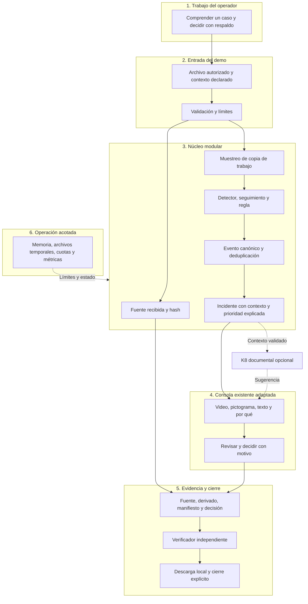

# TAKYA · Estrategia de procesamiento, backend y arquitectura

Estado: **diseño de la próxima iteración, no implementación**. Sin BD. [Índice](00_INDICE_Y_ESTADO.md).

## 1. Decisión de arquitectura

Conservar Next.js/React/TypeScript. Añadir un núcleo de procesamiento Python con FastAPI y un único proceso trabajador de video. El conjunto es una aplicación modular con un límite de proceso para aislar cómputo costoso. No crear microservicios por cada etapa.

La investigación de `invdes takya` sustenta separar preservación y análisis. Para un archivo finito no hacen falta gateway de cámaras, RTSP, búfer circular, broker, Redis, S3 ni motor geoespacial. Esos componentes del dibujo original pertenecen a otra fase.

## 2. Stack completo y estado

| Capa | Elección | Estado / motivo |
| --- | --- | --- |
| Web y BFF | Next.js **16.3.6**, Node **22.23.3** | Instalados; reutilizar rutas, no bloquearlas con inferencia |
| UI | React/React DOM **19.3.0**, TypeScript **5.9.3** | Instalados; mantener separación por feature |
| Presentación | Tailwind **3.4.19**, Motion **13.4.4**, Lucide, Three **0.186.1** | Existentes; mascota 3D opcional para equipos limitados |
| Contratos web | Zod **4.6.5** | Instalado; validar respuestas del nuevo servicio |
| Backend de análisis | Python **3.12.3**, FastAPI, Pydantic, Uvicorn | Python disponible; librerías propuestas en `.venv`, versiones a fijar al implementar |
| Video | FFmpeg/ffprobe **6.1.1-3ubuntu5** disponible | Inspección, muestreo y derivados; revisar actualizaciones de seguridad antes de exponer cargas |
| Inferencia | ONNX Runtime CPU; comparar una variante pequeña exportable de RT-DETR con detector ligero compatible | Propuesto; elegir pesos/versiones/licencias tras benchmark local |
| Seguimiento | ByteTrack si mejora identidad temporal | Propuesto y condicionado a resultado; no indispensable para un primer cruce simple |
| Evidencia | `hashlib` + `cryptography` para AEAD y firma | Propuesto; librería mantenida, no criptografía propia |
| Estado | Mapa en memoria, un coordinador y cola acotada | Propuesto; una sola instancia, sin recuperación durable |
| Archivos | Directorio temporal privado por sesión | Propuesto; es almacenamiento temporal aunque no haya BD |
| K8 | Recuperación curada + Groq textual existente; fallback local | Código presente; llamada real no verificada aquí |
| Pruebas | `node:test`, TypeScript, ESLint; `pytest` para backend | Herramientas web disponibles; pytest y tests backend por incorporar |
| Operación demo | Equipo local en loopback; UI y backend privados | Recomendado; cloud solo con autorización y diseño de identidad |

Las versiones instaladas son observaciones, no recomendación de seguridad permanente. No cambiar dependencias por la fecha del documento. Registrar versiones exactas y hashes de pesos al crear el backend; un modelo nombrado no implica pesos descargados ni inferencia disponible.

## 3. Dibujo adaptado: seis bloques



**Cambio esencial:** preservar la fuente desde que se recibe; generar derivados para análisis; verificar el paquete al cerrar. K8 queda fuera del camino que decide estados. Fuentes futuras: cámaras/VMS/LPR/IoT entran mediante adaptadores, sin implementarlas en el demo.

## 4. Pipeline y lógica de procesamiento

| Etapa | Entrada → salida | Invariante y error visible |
| --- | --- | --- |
| Recibir | Bytes subidos → `source_id`, archivo `.part` y hash incremental | Un archivo incompleto no puede figurar preservado |
| Inspeccionar | Archivo completo → tamaño, códec, resolución, duración y PTS | Extensión/MIME no bastan; límites también sobre lo decodificado |
| Aceptar fuente | Validación correcta → fuente privada de solo lectura para el worker | Hash definitivo, procedencia y autorización registradas antes de inferencia |
| Preparar análisis | Fuente → muestras con tiempo de fuente | Reducir resolución solo en derivados; no ocultar el costo de decodificación |
| Detectar | Muestras → cajas y score del detector | Persona detectada no significa intrusión confirmada |
| Aplicar regla | Cajas, zona y tiempo → observación | Punto inferior central dentro del polígono durante umbral definido |
| Agrupar | Observaciones → candidato/incident_id | Deducción temporal por pista y zona; no fusionar personas diferentes por cercanía solamente |
| Contextualizar | Candidato → clip, referencias, motivo de prioridad | Contexto declarado y faltante explícitos; no inventar horario/cámara |
| Revisar | Caso → decisión y motivo del operador | Autor y versión se validan en servidor; LLM no cambia la decisión |
| Exportar | Fuentes y registro → paquete validado | Inventario y hashes completos; fallo de escritura bloquea descarga final |

Regla inicial propuesta: cámara fija, polígono normalizado y permanencia de prueba de 2 segundos; comparar con regla de cruce. Un umbral de permanencia excluye por definición cruces breves: etiquetarlos y evaluar por separado. Los cortes de plano invalidan la continuidad de una pista. La cámara debe ser fija o declarar el análisis no aplicable.

Una configuración incluye `rule_version`, `zone_version`, punto de referencia, umbral de score, tiempo de permanencia, tolerancia de pérdida de pista y cooldown. No ajustar el cooldown para esconder falsas alertas ni agrupar todos los eventos de una cámara en un único incidente.

## 5. Qué optimizar y qué no confundir

- **Muestreo temporal:** proponer 1 y 2 FPS como configuraciones a evaluar. Inferir menos cuadros puede ahorrar trabajo, pero una acción rápida puede quedar fuera. El video comprimido puede exigir decodificar cuadros intermedios.
- **Substream:** opción para la futura cámara en vivo; el archivo cargado puede no tenerlo. Crear una copia reducida tiene costo que debe entrar en el benchmark.
- **I-frame:** no aparece obligatoriamente cada segundo. Extraer únicamente cuadros clave puede producir huecos incompatibles con la regla temporal.
- **Corte:** `-c copy` copia paquetes sin recodificarlos; no garantiza un intervalo exacto ni archivo idéntico al original. Preservar la fuente y documentar la correspondencia temporal. [FFmpeg](https://ffmpeg.org/ffmpeg.html#Streamcopy).
- **JSON:** representa observaciones y referencias; no es compresión reversible del video. Un JSON pequeño no prueba que conservamos su información.
- **VLM:** descripción opcional de muestras de un candidato; no requisito para la decisión ni método para deducir intención delictiva.

Registrar intervalo solicitado y correspondencia efectiva con la fuente usando PTS/time_base y verificación del corte. `start_time` del clip remultiplexado no basta: puede empezar en cero tras reajustar timestamps. Si no se puede demostrar la correspondencia, usar el archivo completo para revisión y declarar que el derivado no fue generado.

## 6. Contratos: observación, caso y decisión

Contratos propuestos `v1`, independientes de React. `Event` es una observación atómica; `Incident` agrupa observaciones de una misma situación; `Decision` expresa la acción humana. No guardar un párrafo LLM como fuente de verdad de los tres.

| Objeto | Campos mínimos |
| --- | --- |
| `Source` | `id`, `sha256`, `size_bytes`, `duration_ms`, `received_at`, `capture_time` nullable, procedencia, autorización, códec, resolución, PTS/time_base |
| `Job` | `id`, `session_id`, `source_id`, `state`, `progress`, `error_code`, `config_hash`, timestamps de etapas, `revision` |
| `Observation` | `id`, `source_id`, intervalo en tiempo de fuente, pista, cajas, categoría observada, detector y regla versionados |
| `Incident` | `id`, `observation_ids`, zona, prioridad por regla, motivos, incertidumbre, `evidence_refs`, `revision`, origen del análisis |
| `Decision` | `id`, `incident_id`, `expected_revision`, tipo, motivo, sesión/actor, instante de servidor, alcance simulado |
| `EvidencePackage` | inventario, hashes de fuente y derivados, transformaciones, tiempos, decisión, análisis separado, versión de formato y estado de verificación |

Todos los tiempos de proceso en UTC; tiempo relativo de escena en milisegundos desde la fuente. Si no se conoce la fecha de grabación, `capture_time=null` y etiqueta «hora de captura desconocida». No usar la hora de carga como hora del incidente. Conservar huso original y procedencia del reloj cuando se conocen.

Restricciones: números finitos y acotados; booleanos no aceptados como números; límites enteros y texto; referencias del caso deben pertenecer a su fuente y sesión; `0 ≤ inicio < fin ≤ duración`. El score del detector no representa probabilidad de delito. En UI, no presentar «91% de certeza» sin calibración.

## 7. Adaptar los contratos existentes con compatibilidad

El esquema actual de incidentes exige al menos dos cámaras y usa un catálogo de escenarios (`smoke`, `fire`, etc.). Un video nuevo de una sola cámara y una regla de zona **no encajan directamente**. No fabricar una segunda cámara para satisfacerlo.

Crear contratos de análisis `v1` separados y un adaptador de presentación, o evolucionar mediante un discriminante de modo. Preservar las sesiones antiguas y sus pruebas. Definir cómo se muestran una fuente y un candidato sin alterar las reglas de los ejercicios existentes.

`schemas/cognitive.ts` ya distingue orígenes y valida referencias. Su respuesta actual usa `alertId`: mapear observaciones a avisos verificables o introducir un esquema nuevo. No añadir `MODEL_SERVICE` a una evaluación curada para aparentar inferencia. La decisión de una sesión importada desde `localStorage` no es una decisión autenticada del servidor.

## 8. API propuesta del demo

Rutas nuevas orientativas, **todavía inexistentes**. Next BFF valida sesión y coordina el backend privado; el navegador no recibe claves del worker ni del proveedor. No cargar archivos grandes mediante Server Actions. En local, usar streaming acotado en el BFF o un canal privado equivalente con identidad; nunca `arrayBuffer()` del video completo como diseño por defecto.

| Método y ruta | Contrato / errores |
| --- | --- |
| `POST /api/analysis/sessions` | Crea sesión efímera; cookie HttpOnly, SameSite, origen validado. En demo local no equivale a identidad laboral verificada |
| `POST /api/analysis/uploads` | Video en streaming; límites; devuelve `source_id` al aceptar. 400/413/415/422; limpia cargas parciales inválidas |
| `POST /api/analysis/jobs` | `source_id`, zona y configuración; `Idempotency-Key`; devuelve 202 y `job_id`, o 429/503 si no hay capacidad |
| `GET /api/analysis/jobs/:id` | Estado/progreso; 404 para recurso ajeno o inexistente; no filtrar rutas locales |
| `POST /api/analysis/jobs/:id/cancel` | Cancelación idempotente; estado terminal no se reabre |
| `GET /api/analysis/incidents/:id` | Observaciones, sugerencia y evidencia autorizada |
| `GET /api/analysis/evidence/:id` | Streaming con Range acotado, tipos permitidos y permisos por recurso; fuera de `public/` |
| `POST /api/analysis/incidents/:id/decisions` | Motivo y revisión esperada; 409 por conflicto; validación real en servidor |
| `POST /api/analysis/incidents/:id/export` | Prepara paquete, devuelve estado; descarga solo cuando está verificado |
| `POST /api/analysis/sessions/:id/close` | Cierre explícito y advertencia de pérdida; impide carreras con exportación/trabajo activo |

La cookie de sesión permite aislar ejercicios; para videos privados de clientes hace falta autenticación real y autorización de personas. CORS/Origin no autentican usuarios. La comunicación BFF–Python requiere credencial efímera de servicio, permisos acotados y escucha en loopback; en red, TLS y control explícito de identidad.

## 9. Sin BD: memoria y temporales con límites honestos

**Diseño mínimo:** una instancia del coordinador, un worker, mapa de trabajos e idempotencia en memoria y directorio privado de sesión. Cola máxima propuesta de 1 trabajo activo + 1 en espera. Bloquear carga adicional si excede presupuesto. No usar varios workers Uvicorn con mapas locales divergentes.

Perfil inicial a medir: MP4/H.264, hasta 60 segundos, 1280×720, 32 MiB por archivo y una fuente por trabajo; paquete en claro máximo de 64 MiB. Estos límites son de aceptación propuestos, no capacidad medida. Rechazar lo que los supera y mostrar límites antes de cargar. Evitar transcodificar formatos desconocidos sin cupo y límites.

Presupuesto inicial propuesto: decodificación con uno o dos hilos, un modelo residente y techo de memoria del worker acordado tras medir. RAM de este equipo observada: aproximadamente 3,7 GiB; no cargar a la vez varios modelos ni iniciar compilaciones web durante un ensayo de inferencia. Si el modelo no cabe o no cumple el ensayo, cambiar a variante menor o equipo de demo definido; no prometer rendimiento local inexistente.

```text
directorio temporal privado/
  sesión opaca/
    source.bin          fuente aceptada, sin sobrescritura
    analysis/           muestras y derivados identificados
    exports/            parciales y paquete publicado al completar
```

Permisos propuestos: directorios 0700 y archivos 0600; fuentes solo lectura para el worker. No introducir datos nuevos en `public`, `localStorage`, Git ni logs. `.tmp` y exportaciones fuera de las rutas públicas; al implementar, revisar exclusiones de Git.

Un reinicio pierde mapa, sesiones, revisiones e idempotencia. Responder 410 o exigir nueva sesión cuando expira una sesión reconocida; no reintentar decisiones como si no hubiera ocurrido nada. Los temporales huérfanos se identifican con metadatos técnicos de sesión, sin autorizar su lectura, y su limpieza solo aplica al material de demo autorizado para eliminación.

TTL propuesto: 30 minutos de inactividad con aviso previo de 5 minutos, pausa mientras hay trabajo o descarga activa y máximo de sesión de 2 horas. Definir explícitamente qué ocurre al máximo: cancelar nuevo trabajo, ofrecer exportación y pedir cierre; no borrar silenciosamente una fuente que se prometió conservar. Para el demo solo usar material sin obligación de conservación y explicar la caducidad antes de cargar.

**Límite de producto:** sin registro durable no hay recuperación de decisiones tras caída, auditoría persistente ni cadena de custodia institucional completa. Si el caso exige conservación legal, este perfil se rechaza y se pasa al diseño de piloto con persistencia y política de retención. Un botón de descarga no acredita recepción verificada de un tercero.

## 10. Módulos profundos y patrones con propósito

Estructura futura propuesta; no se crean estos módulos en esta entrega:

```text
backend/takya/
  api/          HTTP, identidad de sesión, errores y límites
  application/  casos de uso y coordinación de trabajos
  domain/       reglas, contratos y transiciones puras
  video/        ffprobe, PTS, muestreo y derivados
  detection/    detector y asociación temporal
  evidence/     fuente, manifiesto, cifrado y verificador
  runtime/      cola, proceso worker, cuotas y cancelación
  adapters/     modelos y proveedor de lenguaje
backend/tests/
```

| Patrón | Problema que resuelve | Límite |
| --- | --- | --- |
| Monolito modular | Un despliegue lógico y cambios coherentes | Separar worker por recursos no obliga a microservicios |
| Puertos y adaptadores | Cambiar detector/proveedor sin reescribir reglas | Interfaces pequeñas; evitar capas vacías |
| Máquina de estados | Impedir completados falsos y decisiones incompatibles | Tres ciclos separados: trabajo, incidente y exportación |
| Comandos e idempotencia | Doble clic/reintento no duplica trabajo | Garantía solo durante la vida del proceso en esta fase |
| Control optimista de revisión | Dos solicitudes no sobrescriben una decisión | Lock y comparación dentro del coordinador |
| Publicación atómica | Paquete parcial no visible como válido | Escribir conjunto privado y publicar índice/renombre al terminar |
| Adaptador de compatibilidad | Convivencia de práctica y análisis nuevo | No convertir fixtures curados en inferencia real |

Estados de trabajo: `RECEIVING → VALIDATING → READY → QUEUED → ANALYZING → COMPLETED`; terminales `FAILED`, `CANCELLED`, `EXPIRED`. Un fallo de preservación no llega a `READY`.

Estados de incidente: conservar decisión humana separada (`PENDING`, `IN_REVIEW`, `VERIFIED`, `DISMISSED`, `ESCALATED`) con evidencias revisadas y motivo. Escalar en este demo solo registra una intención/derivación simulada.

Estados de exportación: `PREPARING → VERIFYING → READY → DOWNLOADED`; `FAILED` ante error. `DOWNLOADED` no es `RECEIVED_BY_AUTHORITY`. No crear un ACK institucional ficticio.

## 11. Instrumentación y comparación

Medir `upload_ms`, `queue_ms`, `probe_ms`, `analysis_ms`, `time_to_first_candidate_ms`, `clip_ms`, `package_ms`, `verify_ms`, cuadros inferidos, bytes de fuente/derivados, CPU y RAM pico. Los campos de contenido del video no van a logs operativos.

Cálculos de referencia, no resultados: a 3,5 Mbps, 60 segundos son 26,25 MB; 15 segundos son 6,5625 MB. A 25 FPS, un minuto tiene 1.500 cuadros; 2 FPS produce 120 inferencias, 92% menos si se infiere una vez por muestra. Ese porcentaje no describe ahorro total ni precisión.

Comparar extremo a extremo con el mismo hardware, detector, corpus y carga. Registrar frío/caliente; no excluir fallos ni tiempo de creación de derivados. El postcontexto añade espera en vivo, aunque no haya que esperarlo al analizar un archivo ya grabado. RTF = tiempo de análisis / duración del archivo; no confundirlo con tiempo humano para decidir.

## 12. Cloud y evolución: condiciones de entrada

**Preferencia confirmada del fundador:** minimizar costos y cifrar localmente. La evolución siguiente es un repositorio local cifrado y respaldo separado cuando el piloto requiera custodia; no se seleccionó proveedor cloud. Las alternativas del párrafo siguiente quedan como investigación opcional, no como dependencia ni compra. Detalle en [decisión de cifrado local](11_DECISION_CIFRADO_LOCAL_LEYES_ODS.md).

Local primero para el demo. Una UI alojada en cloud no accede automáticamente al worker del notebook. No abrir puertos ni túneles para presentar el prototipo sin diseñar y autorizar identidad, TLS, cuotas y tratamiento de datos. Las funciones efímeras con límites de carga/tiempo no son un worker durable por sí solas.

Evolución si el piloto la exige: decisiones/versiones durables y repositorio local cifrado con respaldo separado; evaluar PostgreSQL solo cuando se autorice persistencia y gestión de claves local protegida. Una cola durable requiere una necesidad real de reintentos entre reinicios. PostGIS, Redis y almacenamiento de objetos cloud quedan como investigación opcional, no como elecciones adoptadas. No seleccionar servicios cloud ni afirmar costos sin autorización y sin definir carga y retención.

Referencias de diseño: [FastAPI sobre trabajos pesados](https://fastapi.tiangolo.com/tutorial/background-tasks/) y [RT-DETR oficial](https://github.com/lyuwenyu/RT-DETR). Guía BFF local de Next.js: `node_modules/next/dist/docs/01-app/02-guides/backend-for-frontend.md`; depende de la instalación y no se publica con el repositorio. Leer la guía instalada antes de escribir código Next.
