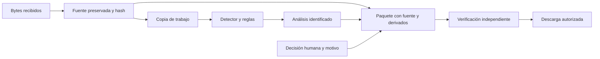

# TAKYA · Evidencia verificable, seguridad y pruebas desde el día uno

Estado: diseño y criterios por implementar. [Índice](00_INDICE_Y_ESTADO.md) · [Arquitectura](02_BACKEND_DATOS_ARQUITECTURA.md).

## 1. Qué debe significar el sello TAKYA

**«Puedes comprobar qué archivo recibimos, qué transformamos y qué decidió una persona».** Esa es la promesa técnica a demostrar. El sello debe mostrar comprobaciones concretas, fecha y alcance; no una insignia decorativa.

| Nivel | Texto permitido al completarlo | Evidencia requerida |
| --- | --- | --- |
| E0 · Estado actual | «Material de práctica y señales curadas» | Procedencia documentada; no afirmar custodia |
| E1 · Integridad | «Fuente recibida y derivados verificados» | Hashes recalculados, inventario completo y referencia protegida |
| E2 · Confidencialidad | «Paquete cifrado y autenticado» | AEAD, prueba de descifrado y rechazo de clave/tag incorrectos; gestión de clave declarada |
| E3 · Custodia operativa | «Registro de custodia y entrega verificada» | Identidad real, registro durable protegido, receptor autenticado, retención y recuperación ensayadas |

El objetivo del demo es E1 y, si el equipo quiere demostrar confidencialidad, E2. E3 no cabe en el perfil efímero sin identidad verificada ni almacenamiento durable. No usar «base de datos de grado militar», «aprobado por FBI/CIA», «invulnerable», «prueba jurídicamente irrefutable» o «cumplimiento automático». No existe evidencia de tales atributos.

## 2. Tres propiedades y sus límites

**Confidencialidad:** quién puede leer. **Integridad:** qué modificaciones se detectan. **Trazabilidad:** qué se sabe de procedencia, accesos, transformaciones y decisiones. También hace falta disponibilidad: una clave perdida o un paquete irrecuperable destruyen el valor de la protección.

SHA-256 comprueba consistencia contra un valor confiable desde que se calculó. Un atacante que sustituye archivo y manifiesto puede recalcular ambos. Proteger el registro de referencia; un hash junto al archivo, sin esa protección, no autentica al emisor. La preservación requiere procedimientos además de algoritmos. [NIST IR 8387](https://nvlpubs.nist.gov/nistpubs/ir/2022/NIST.IR.8387.pdf).

AES-GCM autentica datos para quien posee la clave; no identifica públicamente a una persona ni acredita lo ocurrido ante una cámara. Un manifiesto firmado tampoco demuestra que la cámara fuera genuina ni que el video no se manipulara antes de ingresar.

## 3. Dos caminos, sin confundir evidencia y análisis



Reglas: no sobrescribir la fuente; no “mejorar” caras o patentes con IA generativa; registrar recorte, reencuadre, cambio de FPS/resolución, audio eliminado y remultiplexado. Un derivado sirve para revisar; no debe presentarse como original. Los clips periodísticos existentes tienen transformaciones y no acreditan continuidad entre planos.

## 4. Paquete mínimo propuesto

```text
paquete-demo/
  sources/         bytes del archivo recibido
  derivatives/     clip de consulta, si se generó
  manifest.json    inventario, hashes y procedencia
  analysis.json    observaciones y sugerencias versionadas
  decision.json    revisión humana y motivo
  session-log.jsonl acciones del ejercicio, alcance efímero
  verification.txt instrucciones y resultado del verificador
```

Manifiesto: formato y versión propios (`takya-evidence-v1`, sin usar ISO como certificación), identificadores opacos, hashes/tamaños de todo archivo de contenido, fuente y relaciones, tiempos relativos/absolutos con procedencia, intervalo solicitado/efectivo, transformaciones/versiones, modelo/pesos/configuración, actor de práctica y alcance de identidad. Un archivo no puede incluir su propio hash recursivamente: la firma y huella del manifiesto canónico van en un sobre separado.

No incluir rutas absolutas del equipo, claves, tokens, identificación personal innecesaria ni comentarios libres que expongan a terceros. Evitar PDF en la primera iteración si JSON más instrucciones legibles bastan; acordar formato institucional en el piloto.

## 5. Autenticar y cifrar sin construir criptografía propia

Propuesta E1: serialización determinista explícita de los bytes del manifiesto, hash de esos bytes y firma con una biblioteca mantenida, por ejemplo Ed25519. El verificador comprueba inventario, hashes y firma contra una clave pública **confiable por un canal distinto del paquete**. Incluir una clave pública dentro del mismo ZIP no basta: un atacante podría reemplazarla.

En demo efímero, una clave de sesión generada en memoria puede demostrar firma y manipulación; mostrar su fingerprint por un canal controlado antes de exportar. Declarar que no acredita identidad institucional y que desaparece al reiniciar. Para custodia durable, usar identidad y clave persistente protegida en un keyring local y una política de renovación/verificación; no implementarlas fingiendo que un `.env` es una bóveda completa.

Propuesta E2: empaquetar fuente, derivados y metadatos sensibles **dentro** del contenedor cifrado con AES-256-GCM usando `cryptography`. El manifiesto exterior contiene solo versión, algoritmo, identificador de clave y parámetros no sensibles necesarios para abrirlo. AAD no cifra: información personal en AAD permanece visible.

Generar clave con CSPRNG y nonce de 96 bits nuevo por cifrado bajo la misma clave; gestionar riesgo de reutilización y límites con la biblioteca. No derivar nonce del nombre o timestamp. No guardar clave junto al paquete, en Git, localStorage o logs. Entregarla por canal separado; en demo puede mostrarse una vez a quien exporta, con alcance y pérdida explícitos, sin reproducirla en informes de QA.

Para este notebook, proponer límite de fuente de **32 MiB** y paquete en claro máximo **64 MiB**; reservar disco antes de aceptar la carga y comprobar memoria pico al cifrar/descifrar. Las API AEAD de una sola operación pueden mantener varias copias en RAM. Si se supera el presupuesto, rechazar la operación con motivo; no inventar un protocolo de cifrado por chunks para ocultar el problema.

Publicación: producir todo en carpeta privada de trabajo; validar; publicar el conjunto completo mediante renombre o índice final. Un `.part`, un manifiesto sin archivo o un cifrado sin tag jamás aparecen como exportación lista. La verificación debe hacerse también desde una herramienta separada del generador, sobre la descarga real.

## 6. Amenazas y controles de día uno

| Límite de confianza | Amenaza | Control y prueba requerida |
| --- | --- | --- |
| Navegador → API | Rol/ID de caso falsificado, doble clic o replay | Permiso por recurso en servidor, sesión opaca y revisión esperada; prueba de otra sesión y conflicto 409 |
| Archivo → decodificador | Archivo malicioso, agotamiento de memoria/CPU/disco | Límite de bytes/duración/píxeles/pistas; worker sin privilegios y sin red; timeout y cuota; pruebas corruptas y excesivas |
| Ruta → filesystem | Traversal, nombre ejecutable o symlink | IDs del servidor, rutas dentro de raíz privada, creación exclusiva y rechazo de enlaces; pruebas `../` y enlace externo |
| Coordinador → proceso | Inyección de comandos y procesos huérfanos | Lista de argumentos sin shell, protocolos de entrada permitidos, red denegada y cancelación del grupo de procesos |
| Sesión A → sesión B | Lectura/exportación indebida | Validar propietario en cada endpoint y en streaming; 404/denegación sin revelar existencia |
| Análisis → UI | HTML, hechos sin soporte o referencias ajenas | Esquemas, texto escapado y referencias verificadas en servidor; fuente ajena rechazada |
| Corpus/modelo → sistema | Prompt injection en guía, imagen o chat | Datos no son órdenes; sin herramientas de decisión/borrado/despacho para el LLM; corpus aprobado |
| Temporal → exportación | Sustitución de fuente/manifiesto, parcial o clave perdida | Hash frente a referencia protegida, firma/AEAD según nivel, publicación completa y restauración probada |
| Aplicación → proveedor | Filtración y costo ilimitado | Solo contexto mínimo autorizado, secretos servidor, timeout, límite de tokens/presupuesto y fallback |

La carga necesita controles en capas; la extensión o MIME declarado no bastan. La guía de [OWASP File Upload](https://cheatsheetseries.owasp.org/cheatsheets/File_Upload_Cheat_Sheet.html) respalda validación, límites y almacenamiento fuera del directorio público. El detalle de cuotas y pruebas de esta tabla es propuesta de TAKYA.

## 7. Zero Trust como disciplina comprobable

NIST define Zero Trust sin conceder confianza implícita por estar dentro de la red; identidad y autorización son funciones explícitas. Estar en `127.0.0.1`, tener un rol en JavaScript o comprobar Origin no sustituye esos controles. [NIST SP 800-207](https://csrc.nist.gov/pubs/sp/800/207/final).

En el demo: autorizar cada recurso de sesión, proteger el canal BFF–worker, no admitir rutas/URLs arbitrarias, limitar privilegios del worker, no dar herramientas de acción a K8 y mostrar fallos. En piloto: añadir autenticación individual, permisos de organización, registro durable, claves protegidas y verificación continua según riesgo.

El acceso actual de práctica no es autenticación. Los roles se pueden modificar en el navegador y `localStorage` no es auditoría inmutable. Evitar exponer el nuevo flujo a Internet con ese modelo de acceso. Para datos privados de clientes, la ausencia de identidad real es un bloqueo de alcance, no un detalle cosmético.

## 8. Retención y cierre sin promesas incompatibles

En esta fase, el usuario acepta que el material de demo es temporal y no requiere conservación institucional. Explicar TTL, cierre y pérdida por reinicio antes de cargar. Mostrar si faltó exportar; un cierre explícito puede descartar este ejercicio con confirmación clara de pérdida. No presentar esa eliminación como un protocolo legal de cadena de custodia.

En piloto, política por tipo de fuente y cliente, bloqueo de conservación, receptor autenticado, inventario validado y acuse independiente. Nunca borrar por pulsar «Enviar». Una descarga en navegador no es ACK de Fiscalía, policía ni supervisor. La eliminación lógica no garantiza borrado físico de SSD, swap, cachés o respaldos.

El tratamiento transitorio también requiere autorización y finalidad. La [BCN publica la Ley 21.719](https://www.bcn.cl/leychile/navegar?idNorma=1209272) y su [ficha de vigencia](https://www.bcn.cl/balance-legislativo/detalle/ficha_LEY_21719_2024-12-13); antes del piloto corresponde revisión jurídica vigente y del régimen aplicable. No trasladar exigencias de una actividad o cámara corporal a todo CCTV ni prometer validez judicial por usar un algoritmo.

## 9. Pruebas desde el primer incremento

| Familia | Prueba observable | Criterio de aceptación del demo |
| --- | --- | --- |
| Dominio | Secuencias válidas e inválidas de trabajo/decisión/exportación | Una solicitud no salta revisión, reabre un terminal ni cambia una decisión incompatible |
| Contratos | Booleanos, NaN, infinitos, enteros enormes, tiempos fuera de rango, campos desconocidos | Rechazo explícito y acotado; sin crash ni valores por defecto que oculten el error |
| Ingesta | Vacío, truncado, MIME falso, codec no admitido, duración/píxeles excesivos | Rechazo y limpieza de parcial; fuente válida conserva hash |
| Recursos | Cola llena, timeout, disco lleno, cancelación y worker caído | Estado fallido/cancelado correcto, hijos terminados y UI recuperable |
| Detección | Persona dentro/fuera, cruces breves, sombra, oclusión, sin persona | Conteos por evento y reporte de FN/FP; no basta con que aparezca una caja |
| Deduplicación | Misma pista repetida y dos personas sucesivas | Agrupa lo primero sin ocultar el segundo |
| Tiempo | Cambio de FPS, GOP largo, PTS reajustado y captura desconocida | Fuente e intervalo trazables; nunca inventar fecha de escena |
| Permisos | Otra sesión, IDs enumerados, modificación de rol en cliente | No obtiene video, decisión ni paquete ajeno |
| Evidencia | Original/derivado alterado, archivo faltante y manifiesto sustituido | Verificador rechaza; sustituir clave pública del paquete tampoco pasa contra referencia confiable |
| Cifrado E2 | Clave, nonce, AAD, tag y ciphertext modificados | Descifrado falla sin liberar contenido como verificado; paquete válido recupera bytes idénticos |
| UI | Teclado, 200% zoom, móvil/iPad, texto y movimiento reducido | Flujo completo, foco visible, nombres accesibles, errores comprensibles y sin depender del color |
| IA opcional | Timeout, cuota, prompt injection, cita inexistente, pregunta no cubierta | Abstención/fallo visible; revisión y exportación siguen disponibles |

Fixtures sintéticos o videos propios/autorizados. Tests backend en temporal aislado, sin APIs reales ni imágenes de personas en CI. Los dobles de proveedor verifican errores y contratos; una llamada real de integración se registra por separado.

Orden de entrega: contratos y fuente/verificador → trabajo/cancelación → detector/regla → API/UI → IA opcional. Para cada incremento, implementar pruebas del comportamiento nuevo y regresión relevante. No añadir tests que solo busquen el título de este documento.

## 10. Definition of Done de protección de evidencia

- [ ] El original descargado coincide con la fuente recibida; transformaciones aparecen por separado.
- [ ] Un verificador separado rechaza alteración de contenido, inventario o manifiesto.
- [ ] La referencia de confianza no depende únicamente del paquete verificable.
- [ ] Se ensayó exportación incompleta, cancelación, disco lleno y clave perdida.
- [ ] La UI muestra el nivel real E0/E1/E2 y la caducidad del ejercicio.
- [ ] Un acceso ajeno falla también por API y streaming.
- [ ] No hay claves, videos privados ni conversaciones en logs/repositorio.
- [ ] E2 se anuncia solo después de probar confidencialidad y restauración.

Los ocho puntos están pendientes de implementación en el nuevo pipeline. Las pruebas existentes de la práctica no los cubren.

## 11. Cifrado local y ensayo de fallos

La [decisión actualizada](11_DECISION_CIFRADO_LOCAL_LEYES_ODS.md) prioriza AES-256-GCM local, claves separadas y respaldo local bajo política; no exige nube. Cifrar la exportación no protege automáticamente temporales, swap o disco. La custodia de material real no usa la caducidad del demo como política legal.

Del [material del seminario](10_APRENDIZAJES_SEMINARIO_PDI.md), incorporar como propuesta de aceptación un ensayo integrado: detener worker → mostrar fallo; cortar proveedor → mantener revisión; modificar paquete → rechazar verificación. Ninguno se presenta como test ya implementado.
