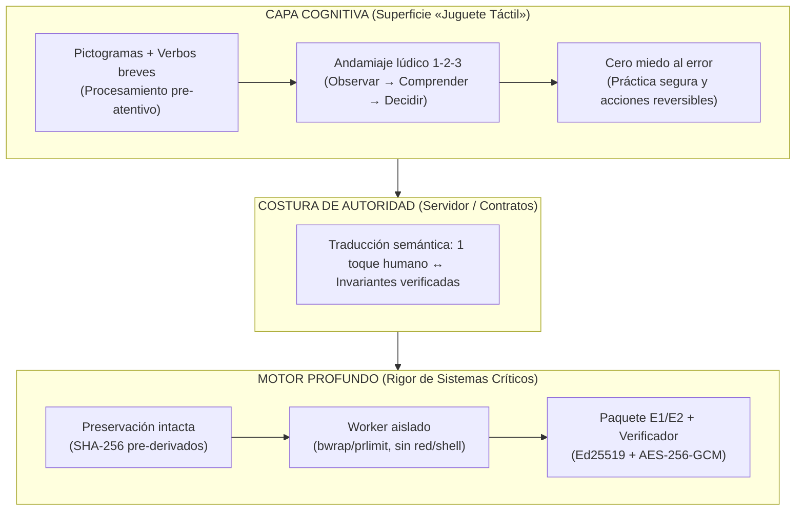

# TAKYA · Capa Cognitiva, Ingeniería de Factores Humanos y Semiótica Pictográfica

**Fecha:** 19 de octubre de 2026 · **Estado:** marco experto de diseño cognitivo y factores humanos (solo documentación; no altera código de producto).

Relacionado con: [00 · Índice del dossier](00_INDICE_Y_ESTADO.md) · [01 · Documento maestro](01_DOCUMENTO_MAESTRO.md) · [03 · Design System](../03_DESIGN_SYSTEM.md) · [04 · K8 e IA](04_K8_ESTRATEGIA_IA.md) · [06 · Flujo del operador](../06_DEMO_OPERATOR_FLOW.md) · [07 · Criterio del CTO](07_CTO_CRITERIO.md) · [ADR 0005](../adr/0005-recorded-evidence-and-cognitive-motion.md).

---

## 1. Tesis central: «Juguete táctil por fuera, rigor crítico por dentro»

El desafío de diseño de TAKYA parte de una asimetría real en la seguridad privada y el monitoreo de CCTV:
1. **En la superficie (operador humano):** Quien vigila cámaras durante turnos extensos suele enfrentarse a fatiga atencional, interrupciones, multitarea en conserjería y, con frecuencia, una **brecha de alfabetización digital o técnica**. Una interfaz densa tipo cabina de avión o llena de jerga informática (`PTS`, `GOP`, `SHA-256`, `ONNX`, `streamcopy`) paraliza la acción, induce miedo a «romper el sistema» y multiplica errores.
2. **En el núcleo (motor y evidencia):** El procesamiento subyacente exige invariantes estrictos de preservación de bytes, aislamiento de procesos sin red ni shell, trazabilidad temporal exacta, firma criptográfica (`Ed25519`), cifrado autenticado (`AES-256-GCM`) y verificación offline independiente.

La solución arquitectónica y cognitiva une ambos mundos mediante el principio de **Módulos Profundos** (*Deep Modules*, John Ousterhout, Stanford) combinado con **Ingeniería de Sistemas Cognitivos** (MIT / Europa / Rusia / Asia):



> **Disciplina documental de TAKYA:**
> - **Sobre el operador:** Diseñar para baja alfabetización digital y adultos mayores es un **requisito universal de accesibilidad y ergonomía cognitiva** (que beneficia a cualquier operador bajo fatiga o estrés), sin asumir ni declarar censos demográficos o diagnósticos clínicos no medidos en las entrevistas ([01_DOCUMENTO_MAESTRO.md](01_DOCUMENTO_MAESTRO.md)).
> - **Sobre el «grado militar»:** En TAKYA, la solidez del backend no se declara con etiquetas publicitarias, sino con **controles verificables y pruebas que pueden fallar** ([07_CTO_CRITERIO.md](07_CTO_CRITERIO.md)): preservación de la fuente original, aislamiento real del worker, rechazo de paquetes alterados y autoridad del servidor sobre estados y decisiones.

---

## 2. Arqueología de la instrucción visual: del analfabetismo histórico al pictograma moderno

La intuición del fundador —*«cómo educaban e instruían rápido cuando la mayoría era analfabeta mediante carteles y señalética»*— tiene un fundamento histórico y neurocientífico directo que dio origen al diseño de información moderno:

### 2.1. Tres hitos históricos de la instrucción sin lectura compleja

| Época / Sistema | Problema que resolvía | Mecanismo cognitivo | Aplicación directa en TAKYA |
| --- | --- | --- | --- |
| **Gremios, heráldica y carteles de oficio (s. XII–XVIII)** | Población mayoritariamente analfabeta que debía identificar servicios, peligros o rutas en segundos. | **Metáfora concreta de objeto/acción:** silueta física de la herramienta o resultado (bota, llave, fuego, campana) con contorno cerrado y alto contraste. | Cada acción en TAKYA se ancla a un verbo físico reconocible (ojo = *Observar*, escudo/check = *Verificar*, campana/flecha = *Escalar*). |
| **Método ISOTYPE (Otto Neurath, Marie Reidemeister y Gerd Arntz, Viena, 1925–1934)** | Educar a trabajadores y ciudadanos con baja escolaridad sobre salud, economía y seguridad sin depender de textos densos ni gráficos abstractos. | *«Las palabras dividen, las imágenes unen»*. Siluetas sin perspectiva ni adornos; **la cantidad se muestra por repetición de unidades**, no escalando áreas que engañan al ojo. | En vez de mostrar porcentajes estadísticos o curvas abstractas, TAKYA muestra **3 pasos visibles**, **conteo discreto de clips (1 de 2)** y tarjetas tangibles. |
| **Señalética industrial, ferroviaria e ISO 7010 (s. XX–actualidad)** | Evitar accidentes fatales en fábricas y transporte donde un trabajador bajo estrés no puede leer un párrafo de instrucciones. | **Codificación redundante (Forma + Color + Pictograma):** círculo/barra (prohibición), triángulo (atención), cuadrado/círculo sólido (acción/condición segura). | Ningún estado de TAKYA depende solo del color ni solo del texto: combina **color semántico + icono geométrico + etiqueta breve**. |

### 2.2. Por qué el cerebro responde antes a un pictograma bien construido

1. **Procesamiento pre-atentivo en paralelo (< 200 ms):** Según la *Feature Integration Theory* (Anne Treisman) y los estudios de percepción visual rápida del MIT (Mary Potter, *Rapid Serial Visual Presentation*), la corteza visual extrae orientación, silueta, color y movimiento **en paralelo** en menos de 100–200 ms, mucho antes de que el cerebro inicie la decodificación fonológica y léxica serie por serie de una oración escrita.
2. **Teoría de la Doble Codificación (Allan Paivio) y directriz W3C WCAG:**
   - Un **texto largo solo** exige lectura secuencial, memoria de trabajo verbal y fluidez lectora.
   - Un **icono abstracto totalmente solo** (sin etiqueta) corre el riesgo de ambigüedad cultural o semántica, especialmente en adultos mayores o usuarios no habituados a convenciones de software moderno.
   - La combinación **Pictograma de silueta clara + Etiqueta de 1 a 3 palabras (≥ 18 px)** activa simultáneamente el canal visual-espacial y el canal verbal, reduciendo el tiempo de reconocimiento y eliminando la ambigüedad ([W3C · Icons Used](https://www.w3.org/WAI/WCAG2/supplemental/patterns/o1p07-icons-used/)).

---

## 3. Síntesis global de Ingeniería de Factores Humanos (MIT, Stanford, EE. UU., Europa, Rusia y China)

Para que TAKYA sea el estándar de referencia en su capa cognitiva, sintetiza las cinco tradiciones más potentes del mundo en factores humanos e interacción persona-máquina:

### 3.1. MIT y EE. UU. — Control Supervisorio y Carga Mental
* **Referentes:** Thomas B. Sheridan (*Man-Machine Systems Laboratory*, MIT), Raja Parasuraman, Christopher D. Wickens (*Multiple Resource Theory*), Mica Endsley (*Situation Awareness*).
* **Aporte clave:**
  - **Control Supervisorio (*Supervisory Control*):** El ser humano es un pésimo monitor pasivo de video continuo (el *decremento de vigilancia* de Mackworth aparece entre los 20 y 30 minutos de observación monótona), pero es un excelente supervisor cuando la máquina filtra candidatos y le entrega un episodio estructurado para decidir.
  - **Tres niveles de Conciencia Situacional (Endsley):**
    1. *Percepción* de los elementos (`Observar` el clip y los momentos marcados).
    2. *Comprensión* de su significado y límites (`Comprender` qué se observa y **qué se desconoce**).
    3. *Proyección* y resolución (`Decidir` entre Verificar, Escalar o Descartar con motivo).
  - **Calibración de confianza y Niveles de Automatización (Sheridan/Parasuraman):** Cuando un sistema muestra un «96% de probabilidad de delito», induce **complacencia por automatización** (el operador aprueba sin mirar). TAKYA prohíbe scores engañosos: presenta candidatos basados en reglas explícitas y exige que el humano marque cada clip como revisado antes de habilitar la decisión.

### 3.2. Stanford y Costa Oeste EE. UU. — Módulos Profundos, Manipulación Directa y Modelo de Comportamiento
* **Referentes:** John Ousterhout (Stanford CS, *A Philosophy of Software Design*), Terry Winograd (Stanford HCI), B.J. Fogg (*Stanford Behavior Design Lab*), Don Norman (*Affordances & Signifiers*).
* **Aporte clave:**
  - **Módulos Profundos (Ousterhout):** Un módulo excelente tiene una **interfaz diminuta y evidente** y una **implementación profunda** que absorbe toda la complejidad técnica. En TAKYA, el botón `Exportar paquete verificable` es un único control comprensible para el conserje, mientras por debajo coordina inventario, hashes SHA-256, firmas Ed25519 y cifrado AES-256-GCM.
  - **Modelo de Comportamiento de Fogg ($B = MAP$):** Una acción ocurre cuando convergen Motivación ($M$), Habilidad/Facilidad ($A$) y Señal/Disparador ($P$). En un turno nocturno de conserjería la motivación fluctúa; por tanto, **la facilidad ($A$) debe ser máxima** reduciendo seis fricciones: *tiempo, esfuerzo mental, esfuerzo físico, ciclos de atención, desviación de la rutina y miedo al error*.

### 3.3. Europa (Dinamarca, Suecia, Austria, ISO) — Ingeniería de Sistemas Cognitivos y Diseño Ecológico
* **Referentes:** Jens Rasmussen (Risø, Dinamarca), Erik Hollnagel (Suecia/Francia, *Joint Cognitive Systems*), Otto Neurath (Austria, ISOTYPE), Estándares ISO 7010 / ISO 9241-110.
* **Aporte clave:**
  - **Taxonomía SRK de Rasmussen (*Skills, Rules, Knowledge*):**
    - *Skill-based (Habilidad sensoriomotora):* Respuesta automática ante señales espaciales/táctiles (pulsar Play, saltar al momento exacto en la barra, tocar un botón grande).
    - *Rule-based (Reglas):* Seguir una secuencia clara `Si pasa X → reviso Y → elijo Z`.
    - *Knowledge-based (Conocimiento analítico):* Razonamiento lento y agotador cuando la interfaz no explica qué pasa.
  - **Diseño de Interfaces Ecológicas (EID):** El objetivo de TAKYA es **bajar la carga del nivel Knowledge al nivel Skill/Rule** haciendo visibles las restricciones del dominio directamente en la pantalla (por ejemplo, mostrar explícitamente la columna **«Lo que NO sabemos / Incertidumbre»** para que el operador no tenga que deducir los límites técnicos del video).

### 3.4. Rusia / Escuela Soviética — Teoría de la Actividad y Psicología de la Ingeniería
* **Referentes:** Alexei N. Leontiev y Lev Vygotsky (*Teoría Histórico-Cultural de la Actividad*), Boris F. Lomov (*Inzhenernaya Psikhologiya* — Instituto de Psicología de la Academia de Ciencias), Vladimir P. Zinchenko.
* **Aporte clave:**
  - **La vigilancia como Actividad Activa, no recepción pasiva:** Lomov y Leontiev demostraron que cuando el operador queda reducido a un espectador pasivo de pantallas, su *modelo conceptual interno* se degrada y aparece la monotonía operativa. La atención solo se sostiene cuando el sujeto ejecuta **acciones materiales o perceptivas con propósito** sobre el objeto de trabajo.
  - **Aplicación en TAKYA:** El operador no «mira un dashboard que se mueve solo». En TAKYA, el carrusel **no avanza solo** y ningún clip se da por visto automáticamente: el operador actúa físicamente sobre la evidencia (salta a los momentos clave, activa o apaga los recuadros de señal, pulsa `Ya revisé este clip` y selecciona el motivo). Esa micro-acción mantiene vivo su modelo mental.
  - **Jerarquía Actividad → Acción → Operación:** La interfaz se organiza según el flujo temporal de la acción humana (`Observar → Comprender → Decidir`), nunca según las tablas técnicas del servidor.

### 3.5. China y Asia Oriental — Estándares de Envejecimiento Activo y Alfabetización Digital Masiva
* **Referentes:** Ministerio de Industria y Tecnología de la Información de China (MIIT — *Especificaciones Generales de Diseño para la Adaptación al Envejecimiento en Aplicaciones Móviles*, 适老化通用设计规范) y estándar nacional `GB/T 37668`, junto con la filosofía japonesa de *Poka-Yoke* (Shigeo Shingo, diseño a prueba de errores involuntarios).
* **Aporte clave:**
  - China logró incorporar a cientos de millones de adultos mayores sin formación técnica al uso diario de herramientas digitales críticas aplicando cinco reglas estrictas que TAKYA adopta en su consola:
    1. **Tipografía base amplia (≥ 18 px)** y opción de **Texto grande** sin recortes ni scroll horizontal, incluso en pantallas de 320 px.
    2. **Prohibición de iconos huérfanos:** Todo pictograma funcional va acompañado de su palabra clave en lenguaje cotidiano.
    3. **Arquitectura plana (máximo 2–3 niveles):** Sin menús desplegables anidados ni árboles profundos.
    4. **Objetivos táctiles generosos (≥ 48×48 px):** Compensa temblor fino de manos, presbicia o uso en pantallas táctiles/móviles económicas.
    5. **Interacción multimodal asistida (Voz + Lectura):** Tal como hace **K8**, ofrecer `Hablar` (dictado revisable antes de enviar) y `Escuchar` (lectura en voz alta de la respuesta), además del botón `Guíame aquí` que indica el primer paso concreto sin teclear.

---

## 4. Gamificación Seria y Efecto «Juguete» para Adultos en Entornos Críticos

Los adultos —igual que los niños— aprenden más rápido, retienen mejor los procedimientos y experimentan menos ansiedad tecnológica cuando la herramienta responde con la claridad táctil de un juguete bien diseñado (*Serious Play* / *Gameful Design*, Sebastian Deterding; *Self-Determination Theory*, Deci & Ryan).

Sin embargo, en seguridad y revisión de evidencia existe una **frontera ética y operativa infranqueable**:

### 4.1. Qué gamificación está PROHIBIDA en TAKYA (y por qué)

> [!WARNING]
> **Ley de Goodhart y riesgo operativo en CCTV:** Si una consola de seguridad otorga puntos por rapidez, rachas por cantidad de alertas despachadas, cronómetros regresivos o tablas de clasificación competitivas (*leaderboards*), **destruye la calidad de la decisión**. El operador empezará a pulsar botones sin ver el video para «ganar puntos» o escalará falsas alarmas por miedo a perder su racha.

Por eso en TAKYA ([06_DEMO_OPERATOR_FLOW.md](../06_DEMO_OPERATOR_FLOW.md), [04_K8_ESTRATEGIA_IA.md](04_K8_ESTRATEGIA_IA.md)):
- **Nunca** se puntúa la velocidad de clic.
- **Nunca** se premia escalar por encima de descartar o verificar.
- **Nunca** se usan sonidos estridentes de casino, confeti ni tono condescendiente o infantil hacia el operador.

### 4.2. Qué gamificación SÍ aplica TAKYA («Jugabilidad Táctil y Progreso Epistémico»)

Aplicamos los cuatro pilares del diseño lúdico industrial (inspirados en la escuela de diseño táctil de Dieter Rams / Fisher-Price clásico y el principio *Kishōtenketsu* de Nintendo de enseñar mediante la acción segura):

| Pilar lúdico-operativo | Cómo se siente («Juguete») | Qué garantiza por dentro («Rigor») |
| --- | --- | --- |
| **1. Andamiaje por niveles desbloqueables (*Poka-Yoke* secuencial)** | Igual que en un juego por etapas, primero completas **1. Observar**, lo que ilumina y desbloquea **2. Comprender**, y finalmente habilita **3. Decidir**. No puedes perderte ni saltar al final por accidente. | Garantiza que ninguna decisión se registre en el servidor sin haber cargado y marcado como revisada la evidencia disponible. |
| **2. Satisfacción táctil e inmediatez (*Chunky Affordances*)** | Botones grandes, sólidos, con micro-transiciones espaciales suaves (Motion) que confirman visualmente: *«Ya revisé este clip ✓»*. El objeto reacciona al instante cuando lo tocas. | Cada confirmación actualiza el estado validado de la revisión y previene doble clic, condiciones de carrera o replay mediante control de revisión en servidor. |
| **3. Progreso por completitud tranquila (Cierre cognitivo)** | Una barra o contador claro (`Progreso de la sesión: 1 de 3 casos resueltos`) que recompensa el **orden y el deber cumplido**, reduciendo la ansiedad de «tener cosas pendientes sin saber cuántas». | Separa estrictamente los estados `completado con candidatos`, `completado sin candidatos`, `cancelado` y `fallido` (un fallo técnico nunca suma como caso limpio). |
| **4. Modo «Caja de Arena» (*Práctica preparada* vs. *Analizar archivo*)** | Un entorno de entrenamiento seguro donde el operador puede tocar todo, probar qué pasa al verificar o escalar y consultar a **K8** sin temor a mandar una patrulla real ni borrar evidencia. | Aísla por completo la sesión de práctica (`localStorage` rotulado) de la autoridad del servidor para análisis real de archivos (`src/app/api/analysis/**` y `backend/**`). |

---

## 5. Leyes Matemáticas y Perceptivas de la Interfaz de TAKYA

Cada pantalla del flujo de TAKYA (`Preparar → Delimitar → Analizar → Observar → Comprender → Decidir → Exportar → Cerrar`) se rige por cinco leyes cuantificables de factores humanos:

### 5.1. Ley de Hick-Hyman (Tiempo de Decisión)
$$RT = a + b \log_2(n + 1)$$
El tiempo de reacción ($RT$) crece logarítmicamente con el número de opciones ($n$).
- **Regla en TAKYA:** En el momento crítico de resolución, el operador nunca enfrenta un formulario de 15 campos. Enfrenta **exactamente 3 caminos mutuamente excluyentes y exhaustivos (MECE)**:
  1. **Verificar** (requiere comprobación adicional en terreno).
  2. **Escalar** (derivar a supervisión/protocolo con evidencia).
  3. **Descartar** (falsa alarma o actividad autorizada comprobada).

### 5.2. Ley de Fitts (Tiempo de Alcance Motor)
$$MT = a + b \log_2\left(\frac{2D}{W}\right)$$
El tiempo para alcanzar un control ($MT$) depende de la distancia ($D$) y del ancho del objetivo ($W$).Para adultos mayores o uso bajo fatiga:
- **Regla en TAKYA:** Altura mínima de controles interactivos **$\ge 48\text{ px}$** (y botones primarios de decisión amplios y agrupados junto al área de enfoque visual), evitando viajes diagonales largos por toda la pantalla.

### 5.3. Teoría de la Carga Cognitiva (Sweller) y Límite de Memoria de Trabajo (Miller / Cowan: $4 \pm 1$ bloques)
La memoria de trabajo humana bajo fatiga retiene entre **3 y 4 bloques (*chunks*)** simultáneos.
- **Carga intrínseca** (la dificultad real de evaluar el video): se preserva y apoya.
- **Carga extrínseca** (ruido visual, jerga técnica, menús confusos): **se reduce a cero**.
- **Regla en TAKYA:** En la vista `Comprender`, la información se divide siempre en **3 bloques fijos con pictograma**:
  1. 👁️ **Qué se observa** (hechos visibles y tiempos relativos en el clip).
  2. ❓ **Qué NO se sabe** (límites de la cámara, origen o autorización no visibles).
  3. 👉 **Siguiente paso sugerido** (orientación procedimental, sin decidir por el humano).

### 5.4. Gramática Pictográfica de 4 Capas de TAKYA

Ningún botón o indicador crítico de TAKYA puede ser un icono mudo ni un bloque de texto plano. Todo control operativo aplica **cuatro capas perceptivas simultáneas**:

```text
┌──────────────────────────────────────────────────────────┐
│  [1. Forma/Borde]  +  [2. Color Semántico]               │
│  [3. Pictograma Silueta ≥20-24px]  +  [4. Verbo 1-3 pal] │
└──────────────────────────────────────────────────────────┘
```

| Acción / Estado | 1. Forma / Contorno | 2. Color semántico (`03_DESIGN_SYSTEM.md`) | 3. Metáfora pictográfica | 4. Etiqueta verbal obligatoria |
| --- | --- | --- | --- | --- |
| **Observar evidencia** | Contenedor rectangular activo | Salvia / Bosque (`#7D9B8A` / `#1B3B2B`) | Ojo abierto / Fotograma con play | `Observar` / `Ver el clip` |
| **Marcar revisión** | Botón ancho con borde confirmado | Confirmación (`#4A7C59`) | Check dentro de escudo/cuadro | `Ya revisé este clip` |
| **Comprender contexto** | Tarjeta estructurada en 3 bloques | Marfil cálido sobre superficie oscura | Lupa / Capas / Balanza de hechos | `Comprender` |
| **Lo desconocido (Límite)** | Recuadro de advertencia serena | Ámbar (`#D99B26`) | Signo de interrogación / Escudo punteado | `Sin confirmar` / `Lo desconocido` |
| **Verificar en terreno** | Botón primario táctil (≥48 px) | Informativo / Salvia (`#4A7C59`) | Binoculares / Escudo de comprobación | `Verificar` |
| **Escalar caso** | Botón primario táctil (≥48 px) | Crítico controlado (`#E05D44`) | Flecha ascendente / Alerta dirigida | `Escalar` |
| **Descartar aviso** | Botón secundario claro (≥48 px) | Neutro / Marfil atenuado | Caja archivada / Trazo de cierre | `Descartar` |
| **Exportar evidencia** | Botón de cierre con candado | Bosque profundo + sello verificado | Candado / Paquete sellado | `Descargar paquete` |
| **Pedir guía a K8** | Botón flotante / Píldora accesible | Acento cálido / Marfil | Silueta K8 / Brújula de paso | `Guíame aquí` / `Hablar` / `Escuchar` |

---

## 6. Matriz de Traducción: Superficie «Juguete» ↔ Motor de Rigor Crítico

Esta tabla gobierna cómo cada paso del flujo de análisis (`PLAN_MAESTRO_DEMO_FINAL.md` §5) traduce una interacción ultrassencilla para el operador en garantías técnicas rigurosas en el backend:

| Etapa del flujo | Lo que ve y hace el operador (Superficie «Juguete») | Lo que ejecuta el sistema por debajo (Motor Profundo) | Error humano o técnico que previene |
| --- | --- | --- | --- |
| **1. Preparar** | Una tarjeta grande y limpia: *«Elige el video a revisar»* con semáforo visual de límites (máx. 60 s, 32 MiB) y una casilla clara de uso autorizado. | Streaming a disco temporal privado (fuera de `public/`), cálculo de `SHA-256` en tránsito, validación de contenedor/códec con `ffprobe` sin shell y registro de fuente intacta antes de cualquier derivado. | Evita subir archivos gigantes que cuelguen la RAM (3,7 GiB) o alterar el archivo original recibido. |
| **2. Delimitar** | Toca 3 o 4 puntos sobre una imagen del video para dibujar la *«Zona a vigilar»* (como unir puntos en un cuaderno), o elige una zona predefinida con teclado. | Normalización de coordenadas poligonales $[0,1]$, validación geométrica de polígono cerrado en servidor y congelación de la versión de la regla. | Evita configuraciones de reglas con sintaxis técnica o coordenadas fuera de rango. |
| **3. Analizar** | Una barra de progreso tranquila con estado legible (*«Buscando ingresos en la zona…»*) y un botón grande `Cancelar` si se equivocó de video. | Cola acotada (1 activo + 1 en espera), worker aislado (`bwrap`/`prlimit`, sin red), muestreo determinista con detector ONNX en CPU y terminación limpia de procesos hijos al cancelar. | Evita que el operador confunda un error o cancelación con «todo está seguro (0 incidentes)». |
| **4. Observar** | Reproductor limpio con botones grandes para saltar al instante importante (`Ir al momento`), apagar/encender el recuadro sobre la imagen y hasta 3 fotos limpias del evento. | Recorte con precontexto (15 s) y postcontexto (20 s) acotados a la fuente real, registro de `PTS` exactos y separación estricta entre PNG limpio y capa de overlay en la UI. | Evita que los recuadros de IA tapen detalles clave del video o alteren los píxeles de la evidencia. |
| **5. Comprender** | Tres tarjetas pictográficas: **Qué pasó**, **Qué NO sabemos** y **Qué hacer ahora**. Sin porcentajes falsos de certeza. | Resolución determinista de códigos de motivo, cálculo de contexto faltante (ej. clip empieza a mitad del evento) y validación de referencias en servidor. | Previene el sesgo de automatización (*automation bias*) y prohíbe atribuir identidades o delitos. |
| **6. Decidir** | Tres botones grandes (`Verificar`, `Escalar`, `Descartar`) + elección o dictado de un motivo breve. | Verificación de sesión/autorización por recurso, comprobación de número de revisión esperado (anti-replay / anti-doble clic) y persistencia en autoridad de servidor. | Impide decisiones accidentales sin haber visto el video o sobrescrituras silenciosas. |
| **7. Exportar y Verificar** | Un botón `Descargar paquete sellado` (E1 o E2) y un semáforo físico en el verificador: 🟢 *«Íntegro»* o 🔴 *«Alterado / Incompleto»*. | Generación atómica de `manifest.json`, hashes `SHA-256` de cada archivo, firma `Ed25519` (E1) y cifrado `AES-256-GCM` con nonce único y claves fuera del paquete (E2). | Impide que alguien modifique un video, cambie la decisión o sustituya el manifiesto sin ser detectado. |

---

## 7. Protocolo de Evaluación Empírica (Cómo probar esta capa sin inventar métricas)

De acuerdo con el rigor de TAKYA ([01_DOCUMENTO_MAESTRO.md](01_DOCUMENTO_MAESTRO.md) §6–7 y [09_FUENTES_Y_AUDITORIA.md](09_FUENTES_Y_AUDITORIA.md)), ninguna ventaja cognitiva se anuncia como resultado logrado hasta ejecutar estas cuatro pruebas observables:

1. **Prueba de Comprensión Pictográfica (inspirada en ISO 9186):**
   - *Método:* Mostrar los controles principales (`Observar`, `Comprender`, `Decidir`, `Verificar`, `Escalar`, `Descartar`, `Guíame aquí`, `Lo desconocido`) a operadores del segmento objetivo sin explicación previa del fundador y preguntar: *«¿Qué cree que ocurre si toca aquí?»*.
   - *Umbral de aceptación:* Al menos 4 de 5 participantes en la muestra exploratoria inicial (o $\ge 80\%$ en muestra ampliada) identifican la función correcta y ninguno interpreta la acción opuesta (error crítico).
2. **Prueba de Recorrido Completo sin Asistencia Externa (H1 / H2 del Documento Maestro):**
   - *Método:* 5 operadores completan un caso positivo y un caso negativo/fallido de principio a fin sin intervención verbal del equipo.
   - *Medición:* Tiempo monotónico por etapa, número de errores de navegación, uso voluntario de `Guíame aquí` y reconocimiento correcto de un análisis fallido frente a un análisis «sin candidatos».
3. **Prueba de Calibración de Confianza (Anti-Complacencia):**
   - *Método:* Incluir un caso ambiguo o con contexto incompleto (por ejemplo, una persona autorizada o un recorte donde no se ve el origen).
   - *Criterio de éxito:* El operador lee el bloque pictográfico **«Qué NO se sabe»** y elige `Verificar` o `Descartar` con motivo razonado, en lugar de escalar ciegamente por el solo hecho de ver un recuadro de color en la pantalla.
4. **Prueba de Dignidad vs. Sencillez («Efecto Juguete» sin pérdida de seriedad):**
   - *Método:* Tras usar la consola, preguntar de forma neutra cómo describirían la herramienta a un colega de turno.
   - *Criterio de éxito:* Que la sencillez se perciba como **alivio operativo, claridad y control** («es tan fácil como un juego, no me da miedo equivocarme»), sin que reduzca la seriedad con la que evalúan la evidencia real.

---

## 8. Referencias primarias y estándares de respaldo

- **MIT Supervisory Control & Human Factors:** Sheridan, T. B. (1992). *Telerobotics, Automation, and Human Supervisory Control*. MIT Press. / Parasuraman, R., Sheridan, T. B., & Wickens, C. D. (2000). *A model for types and levels of human interaction with automation*. IEEE Transactions on Systems, Man, and Cybernetics.
- **Stanford Deep Modules & HCI:** Ousterhout, J. (2018). [A Philosophy of Software Design](https://web.stanford.edu/~ouster/cgi-bin/book.php). Yaknyam Press. / Fogg, B. J. (2009). *A behavior model for persuasive design*. Stanford Behavior Design Lab.
- **Ingeniería de Sistemas Cognitivos (Europa):** Rasmussen, J. (1983). *Skills, rules, and knowledge; signals, signs, and symbols, and other distinctions in human performance models*. IEEE SMC. / Hollnagel, E., & Woods, D. D. (2005). *Joint Cognitive Systems: Foundations of Cognitive Systems Engineering*. CRC Press.
- **ISOTYPE y Educación Visual Universal:** Neurath, O. (1936). *International Picture Language: The First Rules of ISOTYPE*. Kegan Paul.
- **Psicología de la Ingeniería y Teoría de la Actividad (Rusia):** Leontiev, A. N. (1978). *Activity, Consciousness, and Personality*. / Lomov, B. F. (1966). *Man and Technology: Essays in Engineering Psychology* (*Chelovek i tekhnika*).
- **Accesibilidad, Iconografía y Envejecimiento Activo (W3C / ISO / China MIIT):**
  - [W3C WAI · Icons Used (Pattern O1P07)](https://www.w3.org/WAI/WCAG2/supplemental/patterns/o1p07-icons-used/): uso de iconos comprensibles acompañados de texto.
  - **ISO 7010**: *Graphical symbols — Safety colours and safety signs*.
  - **MIIT China (2021) / GB/T 37668**: *Mobile Internet Application (App) General Design Specifications for Ageing-Friendly Transformation* (tipografía ampliada, iconos etiquetados, objetivos táctiles amplios, pasos mínimos y asistencia por voz).
- **Diseño Lúdico y Motivación Intrínseca (*Serious Gameful Design*):** Deterding, S. et al. (2011). *From game design elements to gamefulness: defining "gamification"*. / Ryan, R. M., & Deci, E. L. (2000). *Self-determination theory and the facilitation of intrinsic motivation*.
