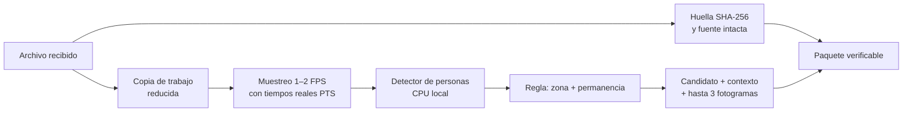
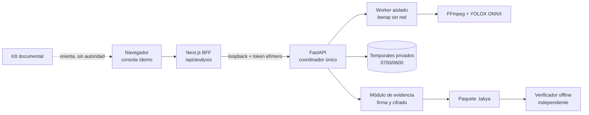

# TAKYA · Documento maestro end-to-end

**Comprender antes de actuar.** Del problema al pitch: investigación, solución, procesamiento de video, backend, capa cognitiva, evidencia, seguridad, privacidad, normativa, estrategia comercial y Agenda 2030 para el Programa Nómada UCN.

**Fecha de corte:** 19-10-2026 · **Versión:** 1.0 · **Estado:** base consolidada para el pitch. Las afirmaciones están clasificadas según la convención de abajo y las puertas G0–G5 del §15 indican qué falta antes de liberar el pitch final.

---

## Cómo leer este documento

Cada dato lleva una etiqueta que el equipo debe respetar al hablar con jueces, clientes o prensa:

| Etiqueta | Significado | Cómo se puede decir en el pitch |
| --- | --- | --- |
| **[O] Observado** | Lo ejecutamos o inspeccionamos nosotros, con fecha | En presente: «TAKYA hace…» |
| **[F] Fuente pública** | Publicado por una institución o estudio, con enlace | «Según [fuente]…» |
| **[R] Reportado** | Lo dijo una entrevista, un informe de IA o un tercero, sin comprobar | «Nos contaron…» / «Estamos validando…» |
| **[P] Propuesto** | Decisión de diseño aún no construida o no medida | «Vamos a…» / «Nuestra hipótesis es…» |
| **[M] Meta** | Umbral de un experimento, nunca resultado | «Nuestra meta es…» |

Regla de oro: **no completar un dato desconocido con una cifra plausible.** Una cifra honesta y modesta convence más a un jurado técnico que un 98 % sin fuente.

Documentos de detalle que este maestro resume: [plan maestro de la demo](PLAN_MAESTRO_DEMO_FINAL.md), [dossier de estrategia](../estrategia/00_INDICE_Y_ESTADO.md), [backend](../estrategia/02_BACKEND_DATOS_ARQUITECTURA.md), [evidencia y seguridad](../estrategia/03_EVIDENCIA_SEGURIDAD_TESTS.md), [K8 e IA](../estrategia/04_K8_ESTRATEGIA_IA.md), [cifrado, leyes y ODS](../estrategia/11_DECISION_CIFRADO_LOCAL_LEYES_ODS.md), [capa cognitiva](../estrategia/12_CAPA_COGNITIVA_FACTORES_HUMANOS_UX.md), [contratos v1](../../contracts/v1/README.md) y la carpeta de investigación `invdes takya` (informes de Astra, Argon, DeepSeek, GLM, Gemini, GPT-OSS y el documento maestro de investigación del 19-10).

---

## Índice

1. [Resumen ejecutivo](#1-resumen-ejecutivo)
2. [El problema](#2-el-problema)
3. [La solución](#3-la-solución)
4. [Competencia y diferenciación](#4-competencia-y-diferenciación)
5. [Cámaras y estrategia de procesamiento](#5-cámaras-y-estrategia-de-procesamiento)
6. [Backend paso a paso y tecnología](#6-backend-paso-a-paso-y-tecnología)
7. [Capa cognitiva: una plataforma que reduce la carga](#7-capa-cognitiva-una-plataforma-que-reduce-la-carga)
8. [Protección de evidencia](#8-protección-de-evidencia)
9. [Ciberseguridad](#9-ciberseguridad)
10. [Privacidad y política de datos](#10-privacidad-y-política-de-datos)
11. [Marco normativo chileno](#11-marco-normativo-chileno)
12. [Inteligencia comercial](#12-inteligencia-comercial)
13. [Agenda 2030 y ODS](#13-agenda-2030-y-ods)
14. [Pitch: relato, demo y defensa](#14-pitch-relato-demo-y-defensa)
15. [Estado real, puertas y hoja de ruta](#15-estado-real-puertas-y-hoja-de-ruta)
16. [Equipo y método de trabajo](#16-equipo-y-método-de-trabajo)
17. [Fuentes](#17-fuentes)

---

## 1. Resumen ejecutivo

**Qué es TAKYA.** Un asistente de revisión de videovigilancia que ayuda al operador a **encontrar, comprender y decidir** sobre un posible incidente, y que **protege la evidencia** con un paquete verificable. La inteligencia artificial propone candidatos; la persona siempre decide.

**El dolor.** Los centros de cámaras crecen más rápido que la capacidad humana de mirarlas. En Antofagasta la central municipal pasó de **30 a 130 cámaras** con operación continua [F: Municipalidad de Antofagasta, 11-05-2026]. La investigación sobre CCTV muestra que observar muchas señales es exigente y que la ayuda automatizada puede aliviar o, si genera falsas alarmas, aumentar la carga [F: Tatler et al.; Dadashi et al.; De Bruyne et al.]. Cuando ocurre un hecho, el operador suele exportar bloques largos de grabación sin saber el minuto exacto, en formatos que no siempre se abren fuera del grabador, y la prueba termina mal enviada o perdida [R: entrevistas e investigación].

**La solución.** Un recorrido de cinco pasos: **Cargar → Delimitar → Analizar → Revisar → Conservar**. TAKYA preserva el archivo original intacto, analiza una copia con un detector local, presenta el candidato con lo que se sabe y **lo que no se sabe**, registra la decisión humana con su motivo y exporta un paquete firmado y cifrado que un verificador independiente comprueba sin internet.

**Qué funciona hoy [O, 19-10-2026].** En este equipo se ejecutó el recorrido completo con un video nuevo:

- carga en streaming;
- huella SHA-256;
- análisis aislado con detector YOLOX-Nano en CPU: **1 candidato** y 3 fotogramas;
- revisión y decisión validadas por el servidor;
- paquete **E2** (firma Ed25519 + cifrado AES-256-GCM) de 1,56 MB.

El verificador offline aceptó el paquete. También **rechazó** un byte alterado, una clave incorrecta y una clave pública sustituida. La fuente dentro del paquete es idéntica bit a bit al original. Pasan 62 pruebas del backend y 31 de la práctica.

**Qué falta para el pitch final.** Material de video **propio y autorizado** de cámara fija, con personas (positivos y negativos), para medir aciertos y errores. También medir tiempo y memoria en el equipo del evento, probar con 3–5 operadores y revisar jurídicamente tres a cinco frases del pitch (§15).

**Diferenciación.** No competimos por tener «la IA más rápida». Nos diferenciamos en **la tarea completa del operador** (de la grabación a una decisión explicada), en la **evidencia verificable con costo local mínimo** y en una **interfaz diseñada para personas bajo fatiga y con habilidades digitales diversas**. Además, cada afirmación se mide.

**Alineación ODS.** Principalmente **ODS 16** (instituciones y justicia: trazabilidad y supervisión humana) y **ODS 9** (innovación local reproducible). Condicionadas a validación: **ODS 11** (seguridad de espacios) y **ODS 8** (trabajo decente del operador) (§13).

---

## 2. El problema

### 2.1 Situación: más cámaras, misma atención humana

| Dato | Estado | Uso |
| --- | --- | --- |
| Antofagasta: la central municipal pasó de 30 a 130 cámaras, con operación continua y refuerzo de operadores | [F] [Municipalidad de Antofagasta, 11-05-2026](https://www.municipalidaddeantofagasta.cl/index.php/noticias/4555-con-mas-operarios-y-el-apoyo-de-carabineros-operaran-desde-central-de-camaras-de-televigilancia) | Usable con fuente |
| «Avanzar hacia 1.000 cámaras» en la comuna | [R] Comunicación municipal; no se encontró un proyecto financiado | Solo como escenario de dimensionamiento |
| Proyecto regional de 1.245 cámaras y 64 pórticos lectores de patentes | [R] Citado por informes de IA; nadie del equipo leyó la fuente primaria | **No usar** hasta abrir la nota oficial |
| Operadores de condominios observan entre 2 y 5 cámaras | [R] Entrevistas relatadas por el fundador; falta ficha de muestra | Hallazgo cualitativo, con atribución |
| Perfil laboral: ofertas piden enseñanza media; algunas aceptan sin experiencia | [F] [Concurso Colina](https://www.colina.cl/wp-content/uploads/2020/10/concurso_operador_central_camaras.pdf), [OMIL Antofagasta, turno 7×7](https://omil.municipalidaddeantofagasta.cl/index.php/ofertas-laborales/job-detail/job-operador-cctv-antofagasta-7x7-rotativo-d%C3%8Da%E2%80%93noche-12331) | Ejemplos de contratación, no estadística nacional |

**Formulación defendible del usuario:** *operadores de videovigilancia con habilidades digitales diversas, expuestos a tareas repetitivas, turnos largos, interrupciones y sobrecarga de información.* La edad no se usa como sustituto de la habilidad digital.

### 2.2 Fatiga cognitiva y observación: qué dice la investigación

| Hallazgo | Estado | Consecuencia para TAKYA |
| --- | --- | --- |
| En tareas de vigilancia monótona, el desempeño de detección cae con el tiempo de observación («decremento de vigilancia», estudiado desde Mackworth en 1948) | [F] Literatura clásica de factores humanos, resumida en el [doc. 12](../estrategia/12_CAPA_COGNITIVA_FACTORES_HUMANOS_UX.md) | El humano es mal monitor pasivo y buen supervisor de episodios estructurados |
| Buscar en una grilla multiplex de CCTV es exigente y su organización afecta el desempeño | [F] [Tatler et al., *Searching in CCTV*](https://pmc.ncbi.nlm.nih.gov/articles/PMC7892658/) | Mostrar un caso a la vez, no otra grilla |
| La automatización parcial cambia la carga y el desempeño del operador | [F] [Dadashi et al., *Semi-automated CCTV surveillance*](https://www.sciencedirect.com/science/article/abs/pii/S0003687012000695) | La IA debe filtrar sin inundar de avisos |
| Las señales visuales generadas por IA influyen en el operador, para bien o para mal | [F] [De Bruyne et al., *AI-based visual cueing*](https://imec-publications.be/bitstreams/6f1b69c9-8d4e-4ead-bd63-034c564be562/download) | Nunca un «96 % de certeza» sin calibrar: causa complacencia |
| «A los 20 minutos se pierde el 95 % de la atención» | [R] Cifra viral; la fuente principal es un blog comercial | **No usar** |
| «90–98 % menos falsas alarmas», «decisión en 2 s», «<100 ms» | [R] Informes de IA, sin medición propia | **No usar** como resultado |

**Conclusión [P]:** el problema no es «la delincuencia en abstracto». Es la **saturación del operador** frente a señales dispersas y la **fragilidad de la evidencia** cuando hay que actuar. Una IA que genera muchas alertas falsas empeora el problema; por eso TAKYA filtra con reglas explícitas y muestra sus límites.

### 2.3 El volumen del video crudo: aritmética, no promesas

Cálculos con unidades decimales, a un bitrate de referencia de 3,5 Mbps (1080p típico). Son cálculos, no mediciones de cámaras de clientes:

| Duración | Peso aproximado | Cuadros a 25 FPS |
| --- | --- | --- |
| 1 minuto | 26,25 MB | 1.500 |
| 1 hora | 1,575 GB | 90.000 |
| 24 horas | 37,8 GB | 2.160.000 |
| 30 días, 1 cámara | 1,134 TB | — |
| 30 días, 10 cámaras a 4 Mbps | 12,96 TB | — |

**Por qué «comprimir más» no resuelve nada [O, aritmética y FFmpeg].** El video de CCTV ya llega comprimido en H.264 o H.265. Meterlo en un ZIP reduce poco o nada, porque esos datos ya tienen alta entropía. Recodificarlo a menor calidad destruye detalles (rostros, patentes, ropa) y cambia la huella del archivo, lo que debilita su valor como evidencia. **El ahorro real viene de no mirar ni guardar lo irrelevante, no de apretar los mismos bytes.**

### 2.4 El dolor operativo concreto

| Momento | Qué pasa hoy | Estado |
| --- | --- | --- |
| Buscar | El operador sabe la franja («entre las 3 y las 4») pero no el minuto; recorre la barra de tiempo del grabador | [R] Investigación del 19-10 y entrevistas |
| Exportar | Saca bloques de 15–60 min; Dahua exporta `.dav` por defecto, que no se abre en un computador común | [R]; el FFmpeg local reconoce el formato `dhav` [O], sin probar variantes reales |
| Conservar | El grabador sobrescribe lo más antiguo cuando se llena el disco; si se tarda en reaccionar, el video desaparece | [R] Comportamiento típico; los plazos varían por instalación |
| Entregar | Se termina grabando la pantalla con el celular o enviando por mensajería, sin huella ni registro | [R] |
| Decidir | Se decide sin registrar por qué, y no hay forma de demostrar después qué se vio | [R] |

### 2.5 Pregunta que TAKYA responde (SCQA)

> **¿Podemos ayudar a un operador a revisar y resolver un caso con menos esfuerzo y menos errores, conservando una relación verificable con el video recibido?**

---

## 3. La solución

### 3.1 Propuesta de valor

**TAKYA convierte una grabación en una decisión explicada y una evidencia verificable.**

1. **Encuentra:** analiza el archivo y propone candidatos dentro de la zona que el operador declara.
2. **Explica:** muestra qué se observó, por qué se activó la regla y **qué no se sabe**: hora de captura, identidad, intención y contexto faltante.
3. **Respeta la decisión humana:** Verificar, Descartar o Escalar, siempre con motivo, validado por el servidor.
4. **Protege:** conserva el original intacto y exporta un paquete firmado (y cifrado, si se elige) que se puede verificar sin internet.

### 3.2 Principios innegociables

| Principio | Qué significa en el producto |
| --- | --- |
| Humano al mando | La IA nunca verifica, descarta, escala, borra ni despacha |
| Dos caminos | Un camino **preserva** (bytes originales y huella); otro **analiza** una copia |
| Honestidad visible | Fallido, cancelado o expirado nunca se muestra como «sin candidatos» |
| Sin identidad ni intención | El detector propone «posible persona en zona», no identifica personas ni delitos |
| Local primero | Procesamiento y cifrado en el equipo; sin nube obligatoria ni costos ocultos |
| Mínimo dato | Sin biometría facial, sin vigilancia del trabajador y sin enviar video a proveedores de IA |

### 3.3 Qué existe y qué viene

| Capacidad | Estado al 19-10-2026 |
| --- | --- |
| Consola de práctica con seis clips, decisiones con motivo, supervisión, historial y K8 documental | [O] Existente y probada |
| Analizar archivo: carga, preservación, análisis real, revisión, decisión de servidor | [O] Construido y recorrido de punta a punta en navegador |
| Paquete E1/E2 y verificador offline | [O] Funcionando, con pruebas negativas |
| Fragmento de contexto (clip recortado) con mapeo temporal probado | [P] Hoy se muestra la fuente completa con el tramo indicado; es la alternativa honesta |
| Archivos largos (5, 15 y 60 min) | [P] Requiere benchmark; la prioridad siguiente es un perfil de 5 min |
| Cámaras en vivo (RTSP/ONVIF), varias cámaras | [P] Fase piloto |
| K8 con contexto del caso | [P] Opcional, después del núcleo |

---

## 4. Competencia y diferenciación

### 4.1 Panorama

| Alternativa | Qué hace bien | Por qué no resuelve todo el problema del operador | Estado |
| --- | --- | --- | --- |
| **NVR/VMS instalado** (Hikvision, Dahua y otros) | Graba 24/7; algunos filtran personas y vehículos (p. ej. Hikvision AcuSense) | Interfaz técnica, exportación compleja y sin paquete verificable orientado a la decisión | [F] [AcuSense](https://www.hikvision.com/en/core-technologies/see-smarter-technology/acusense/); usabilidad [R] |
| **Analítica en el borde** (Axis, Zipstream, edge analytics) | Reduce bitrate y genera metadatos en la cámara | Exige recambio o gama alta; no cubre la decisión ni la entrega | [F] [Axis Zipstream](https://developer.axis.com/video-streaming-and-recording/zipstream/), [edge analytics](https://newsroom.axis.com/en-us/article/edge-analytics) |
| **Frigate** (código abierto) | Detección local eficiente y separación entre detección y grabación | Herramienta técnica para instaladores; no incluye un flujo de revisión ni evidencia | [F] [Frigate](https://docs.frigate.video/configuration/cameras/) |
| **BriefCam / video synopsis** | Búsqueda por atributos y resumen de horas | Licencias y hardware de nivel corporativo, pensados para analistas | [R] |
| **Amped FIVE / laboratorio forense** | Análisis pericial profundo | Herramienta experta que actúa después del hecho, a veces cuando el video ya se perdió | [R] |
| **Cámaras cloud** (Verkada, Rhombus) | Uso sencillo y búsqueda | Exigen reemplazar cámaras y pagar suscripción por cámara | [R] |
| **Revisión manual + bitácora** | Sin costo de software | Lenta, depende de la memoria y la entrega queda sin trazabilidad | [R] |

### 4.2 Lo que **no** decimos

«La competencia procesa video crudo y por eso tarda más» **no está demostrado** y existen contraejemplos (Axis, Frigate). **No usar.** Tampoco decimos «nadie en Chile ofrece esto»: no hicimos ese estudio.

### 4.3 Por qué TAKYA puede ser mejor (hipótesis con prueba asociada)

| Diferencial | Por qué importa | Cómo lo demostramos |
| --- | --- | --- |
| **La tarea completa en un solo recorrido**: de la grabación a la decisión explicada | El valor está en las costuras entre buscar, entender, decidir y entregar | Medir la tarea completa contra el proceso actual del cliente (tiempo, errores y ayudas) |
| **Evidencia verificable de bajo costo** | La prueba se pierde o se debilita en la entrega | Verificador en vivo: un byte alterado se rechaza [O] |
| **Diseño para fatiga y diversidad digital** | Las consolas actuales son técnicas | Prueba de comprensión pictográfica con ≥4 de 5 aciertos [M] |
| **Muestra lo que no sabe** | Evita la complacencia ante la IA | Prueba de calibración con un caso ambiguo (§7.4) |
| **Local, sin recambio de cámaras** | El parque ya instalado no se va a botar | Instalación en un sitio piloto con su grabador actual |
| **Ética operativa**: sin biometría ni vigilancia del trabajador | Confianza del cliente y cumplimiento de la Ley 21.719 | Política de datos auditable (§10) |

**Activos que construyen una ventaja duradera [P]:** conocimiento del trabajo real del operador, corpus autorizado y bien anotado, evaluaciones reproducibles por escena, contratos de evidencia, integraciones mantenidas y una UX validada en terreno. El modelo de IA o la mascota, por sí solos, no son una barrera de entrada.

---

## 5. Cámaras y estrategia de procesamiento

### 5.1 Lo que hay que saber del parque CCTV

| Concepto | Explicación | Impacto en TAKYA |
| --- | --- | --- |
| Analógico HD (DVR/XVR) vs. IP (NVR/VMS) | En lo analógico, el grabador comprime; en IP, cada cámara envía video ya comprimido | En ambos casos llega un archivo o flujo H.264/H.265 |
| Mainstream / substream | Flujo principal de alta resolución para grabar y flujo secundario liviano para ver y analizar | En vivo: analizar el substream y preservar el mainstream [P] |
| Códec H.264 / H.265 (+ «smart codecs») | H.265 pesa menos pero exige más CPU y no todos los navegadores lo reproducen | La demo acepta H.264; H.265 requiere pruebas [P] |
| GOP e I-frames | Solo algunos cuadros son imágenes completas; el resto son diferencias | Cortar sin recodificar cae en I-frames; el corte no es exacto al milisegundo |
| Contenedores `.mp4`, `.mkv`, `.ts`, `.dav` | La «caja» del video | `.dav` es una fricción frecuente; el remuxeo cambia la caja, no el códec |
| RTSP / ONVIF (perfiles S, G, T, M) | Protocolos estándar para pedir video y eventos | Fase en vivo [P]; nuestro JSON es propio, **no** «compatible con Profile M» |

Cuotas de mercado de marcas en Chile: [R] **no verificadas**; no citar porcentajes.

### 5.2 Qué cámaras y archivos procesamos, por fase

| Fase | Entrada | Límites | Estado |
| --- | --- | --- | --- |
| **1 · Demo** | Un archivo MP4/H.264 de cámara fija, una zona | ≤60 s, ≤1280×720, ≤32 MiB; paquete ≤64 MiB; un trabajo activo y uno en espera | [O] Implementado y aplicado por el servidor |
| **2 · Bloques** | Exportaciones de 5 → 15 → 60 min, incluidas `.dav` y H.265 si se validan | Un escalón solo se abre tras medir RAM, disco, tiempo y cancelación | [P] Próximo: perfil de 5 min |
| **3 · Piloto en vivo** | RTSP/ONVIF desde el grabador del sitio | Búfer circular local, protección de segmentos con candidatos, cuotas | [P] |
| **4 · Multicámara / multisitio** | Varias fuentes y correlación | Requiere persistencia, identidad real y custodia | [P] |

### 5.3 Estrategia de procesamiento: «analizar menos, preservar todo»

| Técnica | Qué ahorra | Qué arriesga | Decisión |
| --- | --- | --- | --- |
| Muestrear 1–2 FPS en vez de 25 | ~92 % menos inferencias (2 de 25 cuadros) | Acciones muy breves | [O] Adoptado; elegir 1 o 2 FPS tras evaluar recall |
| Reducir resolución solo en la copia | Cómputo | Objetos pequeños | [O] Adoptado; la fuente queda intacta |
| Barrer solo I-frames | Lectura muy rápida de horas | Con I-frames cada 4–10 s no se puede medir una permanencia de 2,5 s | [P] Solo si conserva el recall acordado |
| Regla de zona + permanencia | Filtra peatones y ruido ambiental | Excluye cruces breves por definición | [O] 2 o 2,5 s, configurable |
| Recorte sin recodificar (`-c copy`) | Clip liviano con calidad original | Inicio desplazado hasta un GOP | [P] Registrar intervalo pedido y efectivo; si no se prueba, mostrar la fuente completa [O] |
| Contexto 15 s antes / 20 s después | Ver llegada y salida | Bordes del archivo | [O] Calculado y marcado como incompleto en bordes |
| Hasta 3 fotogramas PNG limpios, recuadros en capa aparte | Fijación visual sin alterar píxeles | La nitidez no equivale a utilidad pericial | [O] Implementado |

**Ruido vs. señal.** La mayor parte del día de una cámara no contiene incidentes. Esa idea es correcta y guía el diseño, pero los porcentajes del tipo «99,8 % es ruido» o las tablas de duración de delitos por tipo [R] **no tienen fuente**. TAKYA medirá falsos positivos por hora y recall por evento sobre su propio corpus.

### 5.4 Tiempos

| Medición | Estado |
| --- | --- |
| Clip de 11 s, 960×438: análisis completo con 1 candidato | [O] Completó dentro de la sesión de navegador; **sin cronometraje formal todavía** |
| Tiempo por etapa (carga, cola, inspección, análisis, primer candidato, paquete, verificación), RAM pico, frío/caliente | [P] Arnés de medición en preparación; se reporta con n y dispersión |
| «Una hora en 15–35 s» | [R] Hipótesis de investigación, sin medir; **no usar** |

---

## 6. Backend paso a paso y tecnología

### 6.1 ¿TAKYA comprime el video?

**No.** TAKYA **no recomprime ni modifica el original**. Reduce el trabajo de cuatro formas:

1. Analiza **menos cuadros** (muestreo).
2. Analiza una **copia más pequeña**, nunca la fuente.
3. Muestra solo el **tramo relevante** y hasta tres fotogramas.
4. Convierte lo observado en **datos estructurados** (JSON).

El paquete de evidencia incluye la fuente original. El JSON **describe** el video; **no lo reemplaza** ni es una «compresión reversible».

### 6.2 Recorrido técnico, paso a paso (implementado)

| # | Paso | Qué hace el sistema | Invariante |
| --- | --- | --- | --- |
| 1 | **Sesión** | Crea un ejercicio efímero con una cookie HttpOnly/SameSite; muestra límites y caducidad **antes** de cargar | La sesión aísla ejercicios; no acredita identidad laboral |
| 2 | **Carga** | Streaming a un archivo `.part` privado (0600) con SHA-256 incremental; tope de bytes en el BFF y en el backend | Nunca se carga el video entero en la RAM de Next |
| 3 | **Inspección** | `ffprobe` en un sandbox, sin shell: contenedor, códec, duración, resolución y pistas | Extensión y MIME no bastan; un archivo inválido se rechaza y se limpia |
| 4 | **Preservación** | Fuente de solo lectura (0400) y metadatos validados contra el contrato | La hora de captura queda `null` si es desconocida |
| 5 | **Trabajo** | Clave de idempotencia; cola de 1 activo + 1 en espera; cuotas de disco | Doble clic o reintento no duplican el trabajo |
| 6 | **Worker aislado** | `bwrap` + `prlimit`: sin red, sin privilegios, solo lectura de fuente y modelo; FFmpeg muestrea con PTS originales; YOLOX-Nano ONNX en CPU con 1 hilo | Cancelar termina el grupo de procesos; un worker caído es FALLIDO, no «0 candidatos» |
| 7 | **Regla** | Punto inferior central de la persona dentro del polígono durante la permanencia configurada; agrupación por continuidad | Candidato ≠ delito ≠ identidad |
| 8 | **Incidente** | Motivos, desconocidos, contexto pedido y efectivo, hasta 3 PNG con hash | Validado contra el esquema y la duración real |
| 9 | **Revisión** | El operador marca la fuente, cada fotograma y los límites; el servidor exige todas las marcas | No se puede decidir sin revisar |
| 10 | **Decisión** | Verificar, Descartar o Escalar, con motivo y la revisión esperada | Conflicto de versión → 409; sin despacho real |
| 11 | **Paquete** | Snapshot coherente → manifiesto determinista → firma Ed25519 → (E2) AES-256-GCM → verificación → publicación atómica | Un paquete parcial nunca aparece como listo |
| 12 | **Recuperación** | Una utilidad local guarda la clave pública confiable y la clave E2 en archivos 0600, fuera del paquete | La clave nunca va al navegador, a los logs ni al paquete |
| 13 | **Verificación offline** | Herramienta independiente sobre los bytes descargados | Rechaza alteraciones, faltantes, claves incorrectas y claves públicas sustituidas [O] |
| 14 | **Cierre** | Cierre explícito o caducidad (30 min de inactividad, 2 h máximo) | Descargar no borra ni equivale a recepción institucional |

Estados del trabajo: `QUEUED → ANALYZING → COMPLETED | FAILED | CANCELLED | EXPIRED`. Estados del caso: `PENDING → IN_REVIEW → VERIFIED | DISMISSED | ESCALATED`. La interfaz los traduce al español.

### 6.3 Arquitectura

Un **monolito modular** con un límite de proceso para el cómputo pesado. Sin microservicios, base de datos, Redis ni nube en esta fase ([ADR 0006](../adr/0006-analisis-local-sin-bd.md)).

### 6.4 Stack tecnológico (versiones fijadas)

| Capa | Tecnología |
| --- | --- |
| Web | Next.js 16.3.6, React 19.3, TypeScript 5 estricto, Tailwind 3.4, Motion, Lucide, Three.js (mascota K8) |
| Contratos | Zod 4.6.5 (web) · Pydantic 2.14.1 + jsonschema 4.26.0 (backend) · JSON Schema y OpenAPI en `contracts/v1` |
| API | FastAPI 0.148.0, Uvicorn 0.54.0, Python 3.12.3, solo en `127.0.0.1` |
| Video | FFmpeg/ffprobe 6.1.1, sin shell, con argumentos y protocolos acotados |
| IA de visión | ONNX Runtime 1.31.0 CPU · YOLOX-Nano COCO (Apache-2.0), pesos fijados por SHA-256 |
| Imagen | NumPy 2.5.4, Pillow 13.0.0 |
| Criptografía | `cryptography` 50.0.2: Ed25519 y AES-256-GCM; `hashlib` SHA-256 |
| Aislamiento | bubblewrap + prlimit (Linux) |
| IA de ayuda | K8: corpus documental curado + proveedor textual Groq opcional; sin video ni datos del caso |
| Pruebas | pytest (62 backend) · node:test (31 práctica) · ESLint · Prettier · `tsc` · navegador |

Pendiente [P]: documentar la procedencia y la licencia de los pesos del detector en un archivo `MODEL.md` antes del pitch.

### 6.5 Patrones y prácticas

| Patrón | Para qué |
| --- | --- |
| Monolito modular + puertos y adaptadores | Cambiar el detector o el proveedor sin reescribir reglas |
| Máquinas de estado explícitas | Impedir «completados falsos» y transiciones ilegales |
| Idempotencia con huella del contenido | Doble clic o reintento no duplican efectos |
| Control optimista de revisión (`expected_revision`) | Dos solicitudes no se sobrescriben en silencio |
| Publicación atómica | Ningún paquete parcial es visible |
| BFF (Backend for Frontend) | Los secretos nunca llegan a React; un solo origen |
| Contrato primero | Web, backend y verificador comparten esquemas y fixtures |
| Módulos profundos | Una interfaz simple para el operador sobre un motor riguroso |

Prácticas de ingeniería:

- Revisión por pruebas que pueden fallar.
- Ninguna afirmación sin evidencia.
- Archivos congelados (home, landing, login) protegidos por huellas en cada integración.
- Commits pequeños por rama.
- Revisión cruzada entre modelos de IA, con hallazgos ligados a pruebas.
- Sin secretos en el repositorio.

---

## 7. Capa cognitiva: una plataforma que reduce la carga

### 7.1 Tesis

**«Juguete táctil por fuera, rigor crítico por dentro».** El operador ve pocos pasos claros, pictogramas con palabras y botones grandes. Por debajo, el sistema aplica preservación, aislamiento, firmas y cifrado. Detalle en el [doc. 12](../estrategia/12_CAPA_COGNITIVA_FACTORES_HUMANOS_UX.md).

### 7.2 Fundamentos aplicados

| Fundamento | Regla de diseño en TAKYA |
| --- | --- |
| Control supervisorio (Sheridan) y decremento de vigilancia | La máquina filtra y entrega **episodios**; el humano supervisa y decide |
| Conciencia situacional (Endsley): percibir, comprender, proyectar | Flujo **Observar → Comprender → Decidir** |
| Calibración de confianza (Parasuraman) | Sin porcentajes de certeza; bloque visible **«Lo que no sabemos»** |
| Hick-Hyman | Exactamente 3 decisiones mutuamente excluyentes |
| Fitts y accesibilidad (WCAG 2.2, guías de envejecimiento activo) | Objetivos ≥48 px y texto base ≥18 px con opción de texto grande |
| Carga cognitiva (Sweller) y memoria de trabajo (4±1) | Tres bloques fijos: qué se observa, qué no se sabe, siguiente paso |
| Teoría de la actividad (Leontiev, Lomov) | El carrusel **no avanza solo**; el operador actúa sobre la evidencia («Revisé este fotograma») |
| Iconos con texto (W3C) | Ningún icono mudo: pictograma + verbo de 1–3 palabras |
| Poka-yoke | Botones deshabilitados hasta completar la revisión; confirmación de pérdida al cerrar |

### 7.3 Qué no hacemos

- Gamificación con puntos, rankings, rachas o recompensas por decidir rápido.
- Animaciones que distraen; el movimiento reducido está disponible.
- Monitorear el rostro o la fatiga del trabajador.
- Usar el chat K8 como autoridad: no decide, no borra y no despacha.

### 7.4 Cómo probamos que funciona (sin inventar métricas)

1. **Comprensión pictográfica:** se pregunta «¿qué cree que pasa si toca aquí?» sin explicación previa. Meta: ≥4 de 5 aciertos y ninguna interpretación opuesta [M].
2. **Recorrido sin ayuda:** 5 operadores, un caso positivo y uno fallido. Se miden tiempo por etapa, errores, uso de «Guíame» y si reconocen un fallo frente a «sin candidatos».
3. **Calibración:** un caso ambiguo. El éxito es leer «lo que no sabemos» y decidir con un motivo razonado.
4. **Dignidad:** describir la herramienta a un colega. La sencillez debe percibirse como alivio y control, sin restar seriedad.
5. **Carga percibida:** NASA-TLX y SUS antes y después [P].

Hasta ejecutarlas, decimos «diseñado para reducir la carga», no «reduce la fatiga un X %».

---

## 8. Protección de evidencia

### 8.1 Qué significa el sello TAKYA

> **«Puedes comprobar qué archivo recibimos, qué transformamos y qué decidió una persona».**

| Nivel | Texto permitido | Estado |
| --- | --- | --- |
| E0 | «Material de práctica y señales curadas» | [O] Práctica |
| **E1 · Integridad** | «Fuente recibida y derivados verificados» | [O] Firma Ed25519 sobre manifiesto canónico; verificador independiente |
| **E2 · Confidencialidad** | «Paquete cifrado y autenticado» | [O] AES-256-GCM con clave aleatoria y nonce nuevo; clave fuera del paquete |
| E3 · Custodia institucional | «Registro de custodia y entrega verificada» | [P] Requiere identidad real, registro durable, receptor autenticado y acuerdos. **Fuera de la demo** |

### 8.2 Contenido del paquete

`sources/` (bytes originales), `derivatives/` (fotogramas PNG limpios), `analysis.json` (observaciones, regla y modelo separados de la decisión), `decision.json` (decisión humana, motivo y alcance), `session-log.jsonl`, `manifest.json` (inventario determinista con tamaño y SHA-256 de cada archivo), firma separada e instrucciones de verificación.

### 8.3 Límites que decimos en voz alta

- Un hash prueba consistencia **desde la recepción**, no autenticidad previa: no demuestra que la cámara fuera genuina.
- La clave pública debe obtenerse **por otro canal**. Una clave dentro del ZIP no autentica nada.
- Descargar no es entregar a Fiscalía o a la policía. No generamos actas oficiales, RUC ni números de evidencia institucionales.
- Cifrar el paquete no cifra el disco, el swap ni los temporales del equipo.
- No es «grado militar», «irrefutable» ni «certificado». Es un conjunto de **controles verificables**.

### 8.4 Trabajo de piloto [P]

Cifrado de sobre hacia un custodio (X25519), sello de tiempo RFC 3161 (prueba que un hash existía en una fecha si se confía en la autoridad de sellado), manifiestos inspirados en C2PA, calibración de reloj con una referencia contemporánea al hecho y acta técnica acordada con un receptor real.

---

## 9. Ciberseguridad

### 9.1 Enfoque

Zero Trust como disciplina ([NIST SP 800-207](https://csrc.nist.gov/pubs/sp/800/207/final)): nada se autoriza por estar «en la red local». Cada recurso (fuente, trabajo, video, decisión y paquete) se autoriza por sesión, en el servidor.

### 9.2 Amenazas y controles

| Frontera | Amenaza | Control | Estado |
| --- | --- | --- | --- |
| Navegador → API | Rol o ID falsificado, replay, doble clic | Permiso por recurso, revisión esperada, idempotencia, 404 sin revelar existencia | [O] Probado (otra sesión rechazada) |
| Archivo → decodificador | Archivo malicioso, bomba de recursos | Límites de bytes, duración, píxeles y pistas; worker sin red ni privilegios; timeout y cuotas | [O] |
| Ruta → filesystem | Traversal, symlinks | IDs opacos del servidor, creación exclusiva, rechazo de enlaces | [O] |
| Coordinador → proceso | Inyección de comandos, procesos huérfanos | Argumentos sin shell; cancelación del grupo de procesos | [O] |
| Paquete | Sustitución de fuente y manifiesto, clave cambiada | Firma con referencia por otro canal; AEAD; verificador separado | [O] |
| K8 / LLM | Prompt injection, alucinación, fuga | Sin herramientas de acción; sin video ni caso; abstención; proveedor opcional | [O] Diseño; ver [OWASP LLM01](https://genai.owasp.org/llmrisk/llm01-prompt-injection/) |
| Secretos | Claves en cliente o repositorio | Token BFF↔API efímero en archivo 0600; `.env` fuera de git | [O] |

Referencias aplicadas: [OWASP File Upload](https://cheatsheetseries.owasp.org/cheatsheets/File_Upload_Cheat_Sheet.html), [OWASP Cryptographic Storage](https://cheatsheetseries.owasp.org/cheatsheets/Cryptographic_Storage_Cheat_Sheet.html), [OWASP Key Management](https://cheatsheetseries.owasp.org/cheatsheets/Key_Management_Cheat_Sheet.html), [NIST IR 8387](https://nvlpubs.nist.gov/nistpubs/ir/2022/NIST.IR.8387.pdf) (preservación de evidencia digital) y [NIST SP 800-61 r3](https://csrc.nist.gov/pubs/sp/800/61/r3/final) (respuesta a incidentes).

### 9.3 Ensayo de los tres fallos (para mostrar resiliencia)

1. Proveedor de IA caído → la revisión continúa.
2. Worker detenido o cancelado → estado «fallido» o «cancelado», nunca un falso «sin candidatos».
3. Paquete modificado → el verificador lo rechaza [O].

### 9.4 Hoja de ruta de seguridad para el piloto [P]

Autenticación individual con roles reales, registro de auditoría durable y protegido, gestión de claves en keyring o HSM, cifrado de volumen y swap, respaldo separado con restauración ensayada, pruebas de penetración y, a mediano plazo, un sistema de gestión alineado con ISO/IEC 27001.

---

## 10. Privacidad y política de datos

### 10.1 Principios

| Principio | Aplicación |
| --- | --- |
| **Finalidad** | Revisar un incidente y conservar evidencia; nada más |
| **Minimización** | Solo el archivo autorizado; sin rostros identificados, sin patentes leídas y sin perfiles |
| **Sin biometría** | No hay reconocimiento facial ni de identidad |
| **Sin vigilancia del trabajador** | No se monitorea el rostro ni la fatiga del operador |
| **Local** | El video no sale del equipo; no se envía a proveedores de IA |
| **Transparencia** | Límites, caducidad y pérdida de datos se informan **antes** de cargar |
| **Seguridad** | Cifrado, aislamiento y permisos por recurso (§9) |
| **Retención acotada** | Demo: 30 min de inactividad, 2 h máximo o cierre explícito. Piloto: política por cliente y finalidad, con bloqueo por conservación legal |

### 10.2 Borrador de política de privacidad (para validar con un abogado)

1. **Responsable:** el cliente que instala TAKYA define la finalidad y es responsable del tratamiento de sus grabaciones; TAKYA actúa como proveedor o encargado según el contrato.
2. **Datos tratados:** archivos de video autorizados por el cliente, metadatos técnicos (huellas, tiempos, zona) y decisiones del operador con su motivo.
3. **Datos que no tratamos:** identidad de personas filmadas, biometría, ubicación del trabajador y contenido de audio.
4. **Base del tratamiento:** la que corresponda a la actividad del cliente (seguridad de sus instalaciones), evaluada caso a caso; no se asume un consentimiento universal.
5. **Conservación:** según la política acordada y las obligaciones de conservación aplicables; no prometemos «borrado tras enviar» como regla universal.
6. **Derechos de las personas:** canal para solicitudes de acceso, rectificación, supresión y oposición, coordinado con el responsable.
7. **Terceros:** sin transferencia de video. El asistente K8 usa solo texto de ayuda, sin datos del caso.
8. **Incidentes de seguridad:** procedimiento de notificación según la normativa vigente.

---

## 11. Marco normativo chileno

Referencias oficiales consultadas el 18-10-2026. Orientan el diseño; **no certifican cumplimiento**. Antes del piloto se requiere revisión jurídica.

| Norma | Qué implica para el diseño de TAKYA | Qué **no** decimos |
| --- | --- | --- |
| [Ley 19.628](https://www.bcn.cl/leychile/navegar?idNorma=141599), protección de la vida privada | Finalidad, responsables y accesos definidos para las imágenes | Que todo tratamiento exige el mismo consentimiento |
| [Ley 21.719](https://www.bcn.cl/leychile/navegar?idNorma=1209272), nueva ley de datos personales, **vigente desde el 1-12-2026** | Prepararse: minimización, seguridad, derechos de las personas, responsabilidad proactiva | Que ya rige en su totalidad al 19-10-2026 |
| [Ley 21.659](https://www.bcn.cl/leychile/navegar?idNorma=1202067), seguridad privada | Encuadrar el servicio y a los operadores; el art. 4 contempla conservar antecedentes y pruebas → descartar «enviar y borrar» | Que exige AES-256 a todo CCTV |
| [Decreto 209](https://www.bcn.cl/leychile/navegar?idNorma=1213672), reglamento de seguridad privada | Exigencias diferenciadas por actividad; revisar las que apliquen al cliente | Trasladar reglas de cámaras corporales a todo CCTV |
| [Ley 21.663](https://www.bcn.cl/leychile/navegar?idNorma=1202434), marco de ciberseguridad | Preparar responsabilidades y respuesta a incidentes si el cliente entra en su régimen | Que TAKYA o un condominio son automáticamente operadores vitales |
| NCh-ISO/IEC 27037 y NIST IR 8387 (guías de evidencia digital) | Buenas prácticas de identificación, adquisición y preservación | Que el producto está «certificado» con ellas |

Multas, plazos de retención y fechas tomadas de blogs: [R] **no verificados; no citar**.

---

## 12. Inteligencia comercial

### 12.1 Segmentos

| Segmento | Usuario | Comprador | Dolor principal | Prioridad |
| --- | --- | --- | --- | --- |
| Condominios y edificios | Conserje u operador | Administración o comité | Revisar y entregar video tras un hecho | **1 · entrada** [P] |
| Empresas de seguridad privada | Operadores de central | Gerencia de operaciones | Productividad del operador y cumplimiento de la Ley 21.659 | **1 · canal** [P] |
| Comercio, bodegas e industria | Guardia o encargado | Dueño o jefe de seguridad | Robo hormiga, búsqueda en horas de video | 2 [P] |
| Minería y puertos (Antofagasta) | Centros de control | Seguridad corporativa | Perímetros extensos y trazabilidad | 3, con estándares más exigentes [P] |
| Municipios | Central de televigilancia | Municipalidad | Escala (130+ cámaras) y rendición de cuentas | 3, ciclo de compra largo [P] |

### 12.2 Modelo de negocio [P, por validar]

- **Entrada:** piloto acotado de revisión de grabaciones en un sitio, con precio por sitio y capacidad incluida (duración procesada, eventos y soporte).
- **Escala:** licencia local por sitio o por central, más soporte; el módulo en vivo se vende aparte.
- **Canal:** integradores e instaladores de CCTV y empresas de seguridad, que ya tienen la relación con el cliente.
- **Unidad económica:** contribución = ingreso por sitio − (cómputo + APIs opcionales + instalación amortizada + soporte + custodia). El costo de procesar un archivo no es una tarifa mensual por cámara.

### 12.3 Tamaño de mercado: método, no cifra inventada

TAM, SAM y SOM se estiman **de abajo hacia arriba**: sitios accesibles en Antofagasta × precio anual validado; luego compatibilidad técnica y capacidad de soporte. **No** se convierten cámaras proyectadas en clientes ni en ingresos.

### 12.4 Go-to-market en Antofagasta

1. **Validar el dolor:** 5 sesiones de observación con operadores, con consentimiento y notas anonimizadas.
2. **Validar al comprador:** 3 entrevistas con administradoras o empresas de seguridad, con oferta y precio acotados.
3. **Piloto:** un sitio, un responsable operativo, una política de datos firmada y criterios de éxito definidos antes de empezar.
4. **Alianzas [P]:** UCN/USQAI (Programa Nómada), integradores CCTV locales, administradoras de condominios, organismos de capacitación para operadores y diálogo técnico con PDI o Fiscalía sobre formatos de entrega, sin afirmar colaboración hasta que exista.

### 12.5 Métricas del negocio

Tareas completas por sesión, errores relevantes, retorno voluntario al producto, horas de instalación y soporte, pilotos calificados y costo por sitio. No se optimizan «menos alertas» (un sistema que omite incidentes también genera menos) ni «decidir más rápido» de forma aislada.

---

## 13. Agenda 2030 y ODS

Alineación **propuesta y medible**, no certificación. Programa Nómada UCN / USQAI.

| ODS y meta | Contribución de TAKYA | Indicador que mediremos |
| --- | --- | --- |
| **ODS 16** · Paz, justicia e instituciones sólidas (16.3 acceso a la justicia; 16.6 instituciones eficaces y transparentes) | Evidencia trazable y verificable; decisiones humanas reconstruibles; IA sin autoridad | Paquetes verificados correctamente por terceros; casos con decisión y motivo completos |
| **ODS 9** · Industria, innovación e infraestructura (9.5 investigación y capacidad tecnológica) | Innovación local, abierta y reproducible en el norte de Chile; reutiliza el parque instalado | Experimentos reproducibles publicados; recursos y desempeño en hardware modesto |
| **ODS 11** · Ciudades sostenibles (11.7 espacios públicos seguros) | Potencial en espacios públicos y comunitarios, **condicionado** a validarse en ese uso | Solo tras un piloto en espacio público |
| **ODS 8** · Trabajo decente (8.8 entornos de trabajo seguros) | Diseño que reduce la carga del operador, **sin** vigilarlo biométricamente | Errores, ayudas y carga percibida (NASA-TLX) antes y después |
| Transversal · ODS 12 (consumo responsable) | Procesamiento local sin recambio de cámaras ni almacenamiento cloud innecesario | Hardware reutilizado; bytes evitados por el muestreo |

**Riesgos éticos que gestionamos:** sesgo del detector, exposición de personas filmadas, presión por decidir rápido y conservar «todo por si acaso». La seguridad física no justifica recolectar todo ni conservarlo indefinidamente.

---

## 14. Pitch: relato, demo y defensa

### 14.1 Relato de 3 minutos (ajustar a la pauta real)

| Tiempo | Mensaje | Qué se muestra |
| --- | --- | --- |
| 0:00–0:30 | «Antofagasta pasó de 30 a 130 cámaras. Las cámaras crecen; la atención humana no. Conversamos con operadores: cuando pasa algo, buscan en horas de grabación y la prueba se pierde o se envía mal.» | Dato con fuente y hallazgo cualitativo |
| 0:30–0:50 | «TAKYA: comprender antes de actuar. La IA encuentra; la persona decide; la evidencia queda protegida.» | Los cinco pasos |
| 0:50–2:00 | **Demo en vivo** (§14.2) | Ejecución real |
| 2:00–2:30 | «Nos diferenciamos en la tarea completa del operador y en evidencia verificable de bajo costo, sin cambiar cámaras y sin biometría. Aporta al ODS 16 y al ODS 9.» | Tabla de diferenciación y ODS |
| 2:30–3:00 | «Buscamos un sitio piloto en Antofagasta y un responsable operativo para medir tiempo, errores y costo con su grabador actual.» | Petición concreta |

### 14.2 Guion de la demo (90 s, ensayar en el equipo del evento)

1. **Cargar** un video autorizado de cámara fija; mostrar los límites y la caducidad.
2. **Delimitar** la zona con el teclado y confirmar la cámara fija.
3. **Analizar:** progreso real. Si tarda, decirlo; nunca acelerar ni simular.
4. **Revisar** el candidato: fotogramas, «lo que no sabemos» y marcar lo revisado.
5. **Decidir** con motivo: el servidor registra la decisión.
6. **Conservar:** paquete E2 → verificar → **alterar un byte de una copia → rechazo en pantalla.**

Respaldo: grabación del ensayo **rotulada como grabación**. Si el detector falla, se muestra el error y se continúa con la práctica rotulada como práctica.

### 14.3 Preguntas difíciles

| Pregunta | Respuesta |
| --- | --- |
| ¿La IA decide? | No. Propone un candidato y explica sus límites; el operador decide con motivo y el servidor lo registra. |
| ¿Por qué no basta con el grabador o Frigate? | Pueden detectar; no resuelven la revisión, la decisión explicada ni la evidencia verificable. Podemos integrarlos. |
| ¿Qué tan preciso es? | Lo medimos por evento con nuestro corpus autorizado; mostramos la cifra con n, aunque sea modesta. |
| ¿El hash prueba que el video es auténtico? | Prueba que no cambió desde que lo recibimos, frente a una referencia confiable. No prueba lo ocurrido antes. |
| ¿Es legal? | Diseñamos según las leyes 19.628, 21.719 y 21.659; sin biometría ni vigilancia del trabajador. El cumplimiento de cada cliente requiere revisión jurídica. |
| ¿Por qué solo 60 segundos? | Es el perfil seguro de la demo. El siguiente escalón medido es de 5 minutos; no prometemos una hora sin medirla. |
| ¿Qué impide que los copien? | Hoy no afirmamos una barrera consolidada; construimos conocimiento operativo, corpus, evaluaciones e integraciones. |

### 14.4 Registro de afirmaciones (actualizado al 19-10-2026)

| Afirmación | Estado | Uso permitido |
| --- | --- | --- |
| TAKYA carga y analiza automáticamente un video nuevo | [O] Funciona | En presente, con el material autorizado de la demo |
| Fuente intacta, firma y cifrado, paquete verificable | [O] Probado con casos negativos | En presente, mostrando el verificador |
| Precisión, recall, falsos positivos por hora | Sin medir | «Lo estamos midiendo»; mostrar n |
| Reduce la fatiga o el tiempo del operador | Sin medir | «Diseñado para…»; meta de prueba |
| Competencia más lenta por procesar crudo | Sin sustento | No usar |
| Integración policial, validez judicial, acta oficial | No existe | No usar; «trabajo de piloto» |
| Clips periodísticos de la práctica | Licencia de difusión no comprobada | No proyectar en público sin permiso |

---

## 15. Estado real, puertas y hoja de ruta

### 15.1 Puertas para declarar la demo lista

| Puerta | Evidencia necesaria | Estado al 19-10-2026 |
| --- | --- | --- |
| **G0** · Datos y alcance | Video propio autorizado, caso definido, pauta, fecha y hardware | **Pendiente:** falta el corpus autorizado (ruta crítica) |
| **G1** · Ingesta y control | Archivo nuevo, validación, permiso por sesión, hash, cancelación, límites | **Construido y probado** [O]; falta medir recursos en el equipo del evento |
| **G2** · Candidato real | Detector y regla sobre positivos y negativos; omisiones y errores informados | **Parcial:** detector real funcionando sobre un clip de prueba; falta el corpus autorizado (10+10) |
| **G3** · Decisión y evidencia | Fuente real revisada, motivo, exportación y verificación de manipulación | **Demostrado técnicamente** [O]; repetir con material autorizado |
| **G4** · Medición y UX | Comparación reproducible y tareas observadas | Pendiente: arnés de medición y 3–5 operadores |
| **G5** · Ensayo y relato | Dos ensayos completos, respaldo rotulado, cifras con fuente | Pendiente |

### 15.2 Próximos pasos (en orden)

1. **Corpus-0** (dueño: Dani y equipo): grabar con actores que consienten, cámara fija, día y noche: 10 positivos y 10 negativos como mínimo, con permiso de difusión.
2. **Medición:** tiempo por etapa, RAM pico y recall/FP sobre el Corpus-0; elegir 1 o 2 FPS.
3. **Perfil de 5 minutos**, para mostrar el valor de «localizar» en una grabación larga.
4. **Clip de contexto** con mapeo temporal probado.
5. **Pruebas con 3–5 operadores** (§7.4).
6. **Revisión jurídica** de tres a cinco frases del pitch.
7. **Dos ensayos completos** en la máquina del evento y una grabación de respaldo rotulada.
8. Después: K8 contextual opcional, bloques de 15–60 min, `.dav`/H.265 y piloto en vivo.

### 15.3 Riesgos principales

| Riesgo | Mitigación |
| --- | --- |
| No hay video creíble y autorizado | Corpus-0 inmediato |
| Falta de memoria o lentitud en el equipo de la demo (3,7 GiB de RAM) | Medir en la máquina exacta, cerrar todo lo demás, tener un respaldo rotulado |
| Una afirmación exagerada desmontada por un juez | Registro de afirmaciones (§14.4) y revisión jurídica |
| El valor de «localizar» no se ve con 60 s | Perfil de 5 min |
| El verificador es incomprensible para un tercero | Prueba con una persona ajena usando solo las instrucciones |

---

## 16. Equipo y método de trabajo

| Rol | Persona | Responsabilidad |
| --- | --- | --- |
| Dev AI / CTO | Fundador | Arquitectura, IA, implementación y orquestación de agentes |
| Operaciones y procesos | Nehemías Gonzales Vargas (Ing. Civil) | Procesos, infraestructura territorial y validación en terreno |
| Flujos de vigilancia | Daniel Núñez Rojas (Ing. Civil) | Modelamiento operativo y validación técnica |
| Negocio | Ariela (Ing. Comercial) | Modelo de negocio, costos, compradores institucionales y pitch comercial |

**Método de construcción [O].** TAKYA se construye con varios agentes de IA coordinados por un orquestador. Reglas:

- Cada agente es dueño de su módulo.
- Contratos compartidos.
- Una rama por agente.
- Revisión cruzada basada en pruebas.

Una prueba ciega de calidad (52 pruebas ocultas) calibró qué agente asumir para cada tarea. Detalle en el [plan de orquestación](PLAN_ORQUESTACION_MULTIAGENTE.md). Ningún agente decide qué llega a producción: lo decide el equipo.

---

## 17. Fuentes

**Contexto y operación:**

- [Municipalidad de Antofagasta, 11-05-2026](https://www.municipalidaddeantofagasta.cl/index.php/noticias/4555-con-mas-operarios-y-el-apoyo-de-carabineros-operaran-desde-central-de-camaras-de-televigilancia)
- [Concurso de operador, Colina](https://www.colina.cl/wp-content/uploads/2020/10/concurso_operador_central_camaras.pdf)
- [OMIL Antofagasta](https://omil.municipalidaddeantofagasta.cl/index.php/ofertas-laborales/job-detail/job-operador-cctv-antofagasta-7x7-rotativo-d%C3%8Da%E2%80%93noche-12331)

**Factores humanos:**

- [Tatler et al.](https://pmc.ncbi.nlm.nih.gov/articles/PMC7892658/)
- [Dadashi et al.](https://www.sciencedirect.com/science/article/abs/pii/S0003687012000695)
- [De Bruyne et al.](https://imec-publications.be/bitstreams/6f1b69c9-8d4e-4ead-bd63-034c564be562/download)
- Sheridan (1992)
- Parasuraman, Sheridan y Wickens (2000)
- Endsley
- Rasmussen (1983)
- Hollnagel y Woods (2005)
- Leontiev (1978)
- Lomov (1966)
- [W3C Icons](https://www.w3.org/WAI/WCAG2/supplemental/patterns/o1p07-icons-used/)
- [WCAG 2.2, tamaño de objetivos](https://www.w3.org/WAI/WCAG22/Understanding/target-size-minimum.html)

**Tecnología y competencia:**

- [FFmpeg Streamcopy](https://ffmpeg.org/ffmpeg.html#Streamcopy)
- [Axis Zipstream](https://developer.axis.com/video-streaming-and-recording/zipstream/)
- [Axis edge analytics](https://newsroom.axis.com/en-us/article/edge-analytics)
- [Hikvision AcuSense](https://www.hikvision.com/en/core-technologies/see-smarter-technology/acusense/)
- [Frigate](https://docs.frigate.video/configuration/cameras/)
- [RT-DETR](https://github.com/lyuwenyu/RT-DETR)
- [FastAPI](https://fastapi.tiangolo.com/tutorial/background-tasks/)
- [Groq, uso de datos](https://console.groq.com/docs/your-data)

**Seguridad y evidencia:**

- [NIST SP 800-207](https://csrc.nist.gov/pubs/sp/800/207/final)
- [NIST IR 8387](https://nvlpubs.nist.gov/nistpubs/ir/2022/NIST.IR.8387.pdf)
- [NIST SP 800-61 r3](https://csrc.nist.gov/pubs/sp/800/61/r3/final)
- [OWASP File Upload](https://cheatsheetseries.owasp.org/cheatsheets/File_Upload_Cheat_Sheet.html)
- [OWASP Cryptographic Storage](https://cheatsheetseries.owasp.org/cheatsheets/Cryptographic_Storage_Cheat_Sheet.html)
- [OWASP Key Management](https://cheatsheetseries.owasp.org/cheatsheets/Key_Management_Cheat_Sheet.html)
- [OWASP LLM01](https://genai.owasp.org/llmrisk/llm01-prompt-injection/)

**Normativa:**

- [Ley 19.628](https://www.bcn.cl/leychile/navegar?idNorma=141599)
- [Ley 21.719](https://www.bcn.cl/leychile/navegar?idNorma=1209272)
- [Ley 21.659](https://www.bcn.cl/leychile/navegar?idNorma=1202067)
- [Decreto 209](https://www.bcn.cl/leychile/navegar?idNorma=1213672)
- [Ley 21.663](https://www.bcn.cl/leychile/navegar?idNorma=1202434)

**ODS:**

- [ODS 16](https://sdgs.un.org/goals/goal16)
- [ODS 9](https://sdgs.un.org/goals/goal9)
- [ODS 11](https://sdgs.un.org/goals/goal11)
- [ODS 8](https://sdgs.un.org/goals/goal8)

**Material interno:**

- Investigación `invdes takya`: informes de Astra, Argon, DeepSeek, GLM, Gemini y GPT-OSS, y el documento maestro del 19-10. Todos son [R] salvo cuando citan fuentes primarias.
- Informe crítico de Opus 5.5 (19-10-2026).
- Documentos de estrategia 00–12 de este repositorio.

**Auditoría de este documento.** Las cifras de la sección 2.3 son aritmética decimal reproducible. Los resultados [O] provienen de la sesión de construcción del 19-10-2026 (62 pruebas backend, 31 de práctica, recorrido de navegador y verificador offline con tres casos negativos). Los enlaces externos se tomaron de los documentos del proyecto que ya los consultaron; no se revalidaron todos en esta redacción.
