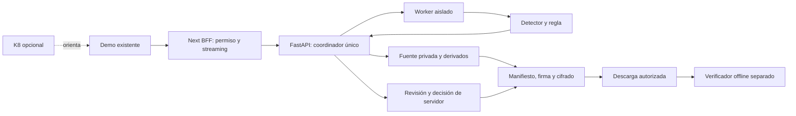

# TAKYA · Plan maestro para construir la demo final

**Fecha:** 19-10-2026 · **Versión:** 1.0 · **Estado:** planificación preparada; implementación pendiente.

**Decisión:** evolucionar exclusivamente la demo existente hacia un recorrido local de archivo autorizado → candidato observable → revisión humana → paquete cifrado verificable. Reutilizar la consola. Home, landing y login quedan congelados.

Esta entrega prepara la construcción con Astra; no implementa el backend ni acredita que la demo objetivo esté lista. El encargo de ejecución está en [PROMPT_HANDOFF_ASTRA.md](../PROMPT_HANDOFF_ASTRA.md). Pegar ese prompt inicia el siguiente trabajo; este documento no cambia el modelo ni ejecuta la implementación.

## Índice

1. [Alcance y archivos protegidos](#1-alcance-y-archivos-protegidos)
2. [Revisión documental y prioridades](#2-revisión-documental-y-prioridades)
3. [Integración crítica de la información nueva](#3-integración-crítica-de-la-información-nueva)
4. [Base técnica y brechas concretas](#4-base-técnica-y-brechas-concretas)
5. [Experiencia final dentro de la demo](#5-experiencia-final-dentro-de-la-demo)
6. [Arquitectura y contratos](#6-arquitectura-y-contratos)
7. [Video y lógica del candidato](#7-video-y-lógica-del-candidato)
8. [Paquete E1/E2 y verificador](#8-paquete-e1e2-y-verificador)
9. [Recursos y recuperación](#9-recursos-y-recuperación)
10. [Hitos de construcción](#10-hitos-de-construcción)
11. [Pruebas y aceptación](#11-pruebas-y-aceptación)
12. [Medición y archivos largos](#12-medición-y-archivos-largos)
13. [Dependencias externas](#13-dependencias-externas)
14. [Ejecución con Astra y cierre](#14-ejecución-con-astra-y-cierre)
15. [Registro de esta entrega](#15-registro-de-esta-entrega)

## 1. Alcance y archivos protegidos

La restricción del fundador es explícita: **solo la demo; la landing y el home ya están bien**. Incluye presentación, navegación, estilos, fondos, textos, marca y comportamiento. El acceso actual permite llegar a `/demo` sin modificar `/login`.

| Tratamiento | Rutas y archivos |
| --- | --- |
| Construcción de la demo | `src/app/demo/**`, `src/features/demo/**`, nuevas rutas `src/app/api/analysis/**` |
| Soporte exclusivo | Nuevo `backend/**`, scripts de arranque/verificación específicos, tests y documentación del incremento |
| K8 existente | Conservar; tocar `src/app/api/k8/chat/route.ts` solo al ejecutar el hito opcional de contexto |
| Excepciones mínimas de raíz | Scripts/dependencias/pruebas indispensables en `package.json`, lockfile, configuración específica de tests y exclusiones de temporales en `.gitignore`; justificar cada cambio |
| Congelados | `src/app/page.tsx`, `src/app/home/**`, `src/app/landing/**`, `src/app/login/**`, `src/features/home/**`, `src/features/landing/**`, `src/features/login/**` |
| Congelados por efecto transversal | `src/app/layout.tsx`, `src/app/globals.css`, `src/components/ui/**`, `src/features/shared/**`, `tailwind.config.ts`, `next.config.mjs`, fuentes y assets públicos existentes |

Crear componentes y estilos exclusivos dentro de la feature si una primitiva compartida requiere otro comportamiento. No reformatear archivos ajenos. No regenerar los seis clips ni ejecutar sus generadores. Las cargas nuevas jamás van a `public/`.

Antes y después de cada hito, comparar hashes e inventario de archivos protegidos. Esta descarga no tiene `.git`: usar snapshot local fuera del árbol público, sin inicializar un repositorio. Los hashes detectan cambios en archivos; la regresión en navegador verifica efectos indirectos de dependencias/configuración.

Fuera de alcance: cámaras RTSP/ONVIF en vivo, varias cámaras, reconocimiento de identidad, OCR de matrículas, clasificación de delitos, despacho policial, portal institucional, BD, nube obligatoria, entrenamiento y nuevos efectos 3D.

## 2. Revisión documental y prioridades

Se inventariaron **49 archivos de texto/documentación** del proyecto antes de esta entrega. Se contrastaron requisitos, evolución histórica, ayuda, skills, medios y diagramas con el código pertinente. Un título «final» no demuestra implementación.

| Material revisado | Aplicación al plan |
| --- | --- |
| `AGENTS.md`, instrucciones aportadas y `CLAUDE.md` | Alcance, permisos, conservación y lectura de Next instalado; CLAUDE remite a AGENTS |
| `README.md`, `ENGRAM.md`, `docs/10_ESTADO_LOCAL.md` | Base y verificaciones históricas; persistencia/API durable propuesta anteriormente queda pospuesta |
| `docs/01_PRD_TAKYA.md` a `05_IDENTIDAD_VISUAL_PPT_A.md` | Historia y diseño; no repetir scaffolding, home/landing ni convertir cifras en resultados |
| `docs/06_DEMO_OPERATOR_FLOW.md` a `09_K8_CONOCIMIENTO_Y_ACCESIBILIDAD.md` | Recorrido, accesibilidad y límites del chat; separar registros antiguos de capacidades actuales |
| `docs/adr/0001` a `0005` | Compatibilidad con la práctica; nuevos ADR al implementar, sin reescribir decisiones aceptadas |
| Tres documentos anteriores de `docs/maestros/` | Antecedentes; rutas Windows, sprints globales, BD/cloud y garantías absolutas no gobiernan este alcance |
| `docs/estrategia/00` a `11` | Producto, backend sin BD, evidencia, IA, roles, fuentes, PDI, cifrado local y límites de difusión |
| Cuatro `docs/skills/*/SKILL.md` y referencias de roles | Ingeniería/revisión; los roles no implican agentes paralelos ni auditoría independiente |
| Seis `docs/knowledge/*.md` | Ayuda vigente: K8 no ve video ni caso; no describir funciones nuevas antes de implementarlas |
| `docs/media/README.md`, plan y manifiesto JSON | Clips curados, transformaciones y permisos no acreditados; no son benchmark de cámara fija |
| Guía/manifiesto de marca y `COJEEV_NOTICE.txt` | Reutilizar identidad y conservar atribución |
| Diagramas SVG/Excalidraw del dossier y mapa PNG completo | Arquitectura propuesta; se inspeccionó el PNG, sin atribuirle backend ejecutable |
| `.qa/local-dashboard.png` | Referencia visual histórica, sin presentarla como prueba actual de navegador |

**Fuente nueva determinante:** `/home/dani/proyectos/invdes takya/DOCUMENTO_MAESTRO_TAKYA.md`, fechado 19-10-2026. SHA-256 observado: `52f02af5d97b7dedd42a073c1d6d865f14b6352ac65f8667a2fee224fd782b35`.

Se revisaron sus diez bloques y se contrastaron con el dossier. Los informes originales de esa carpeta (`astra.md`, `Argon.md`, `deepseek.md`, `glm.md`, `gemenisfinal.md`, `gptoss.md`), README, verificación y procedencia se consultaron como antecedentes por sus secciones pertinentes; no son mediciones independientes. Del Word se inspeccionaron estructura y párrafos relevantes, sin una nueva revisión visual completa de sus tres imágenes. Tampoco se revisaron íntegramente grabaciones del seminario ni todos los enlaces históricos.

Prioridad ante contradicciones: instrucciones vigentes → alcance del encargo → código observado → decisiones del dossier consolidadas aquí → propuestas nuevas contrastadas → antecedentes. El plan histórico de septiembre permanece sin editar; este plan lo sustituye para la siguiente construcción de la demo.

## 3. Integración crítica de la información nueva

| Propuesta del maestro del 19-10 | Decisión | Razón y condición |
| --- | --- | --- |
| Recibir archivos NVR y localizar lo relevante | Adoptar el problema; streaming desde el inicio | El perfil corto es la primera capacidad comprobable; no asumir que el operador conoce el instante |
| Fuente separada del análisis/derivados | Obligatorio | Conservar bytes antes de generar copias |
| Contexto anterior/posterior | Adoptar parametrizado | Inicialmente 15 s antes y 20 s después; acotar a fuente y marcar contexto incompleto |
| Tres PNG limpios con overlays separados | Hasta tres cuando existan | PTS/procedencia; nitidez no equivale a utilidad pericial ni inventa vehículos ausentes |
| JSON separado de descripción IA | Formato propio versionado | No atribuir conformidad ONVIF Profile M o certificación ISO al esquema de TAKYA |
| Cifrado local y verificador offline | Obligatorio para cerrar la demo | E1/E2 comprobados; E3 institucional queda fuera |
| Una hora/2 GB, `.dav` y H.265 | Evolución condicionada | No habilitar en el perfil inicial; medir formatos reales, RAM/disco y exportación antes |
| Barrer I-frames y resolver una hora en 15–35 s | Hipótesis de optimización | Puede omitir eventos entre cuadros clave; comparar con referencia temporal |
| Permanencia 2,5 s y unión de 15 s | Parámetros de experimento | Comparar 2/2,5 s; no fusionar sujetos diferentes por proximidad temporal |
| Porcentajes de ruido, duración de delitos, cuotas de mercado y exclusividad | No incorporar como hechos | Sin medición reproducible que los establezca para este demo |
| Calibrar hora histórica con NTP actual | Posponer | Necesita referencia contemporánea y procedencia del reloj, no solo hora actual |
| Acta oficial NUE/RUC, portal/ACK policial y borrado post-entrega | Fuera de alcance | Sin receptor/acuerdo/integración demostrados; descarga no es recepción institucional |
| «100% legal», «blindado» y retenciones universales | No adoptar | Requieren revisión jurídica/operacional específica; no se resuelven con un algoritmo |
| RFC 3161, C2PA y cifrado de sobre para custodios | Investigación de piloto | Sin contratar TSA ni inventar protocolo criptográfico en la demo |

Recortar un extracto **no reduce el almacenamiento total del original si se conserva**. Remultiplexar a MP4 tampoco cambia por sí solo un códec incompatible. FFmpeg describe copia de paquetes y límites en [Streamcopy](https://ffmpeg.org/ffmpeg.html#Streamcopy). [ONVIF Profile M](https://www.onvif.org/profiles/profile-m/) define interfaces de metadatos/eventos; no convierte un JSON propio en producto conforme.

## 4. Base técnica y brechas concretas

| Existe en esta descarga | Falta construir |
| --- | --- |
| Next/React/TypeScript, feature demo, Zod y motor puro | Servicio Python, worker y API de carga |
| Observar → Comprender → Decidir, motivos e historial local | Autoridad de servidor para el flujo nuevo |
| Seis clips/señales curadas, preferencias y galería | Inferencia sobre archivo nuevo |
| Roles de práctica del navegador | Sesión efímera aislada por recurso, sin identidad laboral verificada |
| K8 documental y adaptador Groq | Contexto autorizado del caso, opcional |
| Exportación JSON de práctica | Paquete E1/E2 y verificador independiente |

Reinspección actual: Node `22.23.3`, npm `10.9.9`, Python `3.12.3`, RAM física reportada aproximadamente 3,68 GiB. FFmpeg, ffprobe, `bwrap` y `prlimit` disponibles; su presencia no demuestra aislamiento efectivo. No existe directorio `backend`. No se inspeccionaron secretos ni se llamó a Groq.

Brechas verificadas en el código:

- `schemas/simulation.ts` exige `cameras.min(2)` y escenarios cerrados: usar contratos nuevos, sin inventar otra cámara ni debilitar la práctica.
- `useDemoNavigation.ts` acepta IDs `DEMO-...`: introducir navegación separada/discriminada para IDs opacos, preservando filtros y Atrás/Adelante.
- `useDemoSession.ts` persiste toda la práctica en `localStorage`: el análisis y las decisiones nuevas no pasan por esa persistencia.
- `schemas/cognitive.ts` usa referencias `alertId`: las observaciones necesitan contrato y resolución autorizada propios.
- El prompt Groq declara que no ve imágenes ni caso: mantenerlo cierto hasta suministrar contexto autorizado real.

## 5. Experiencia final dentro de la demo

Conservar identidad de la consola, texto legible, pictograma con etiqueta, acciones amplias, foco visible y movimiento reducible. No rehacer un dashboard.

Separar dentro de `/demo` **Analizar archivo** y **Práctica preparada**. La práctica conserva sesiones, casos y preferencias. No sumar métricas de ambos modos; la llegada simulada no genera resultados del archivo.

| Paso | Acción | Respuesta observable |
| --- | --- | --- |
| Preparar | Archivo, autorización/procedencia y aceptación de temporalidad | Límites claros; captura desconocida si no hay fuente de reloj |
| Delimitar | Polígono y declaración de cámara fija | Zona válida, alternativa por teclado/coordenadas y regla explicada |
| Analizar | Iniciar/cancelar | Etapa real, tiempo transcurrido y progreso determinado o indeterminado honesto |
| Observar | Reproducir candidato y contexto | Fuente, tiempos relativos, hasta tres PNG y overlays ocultables |
| Comprender | Revisar señales y lo desconocido | Regla que se activó; observación separada de sugerencia |
| Decidir | Verificar/descartar/escalar de forma simulada con motivo | Validación de servidor; sin despacho ni recepción institucional |
| Exportar | Preparar y descargar paquete | Nivel E1/E2 comprobado, verificador e instrucciones de recuperación |
| Cerrar | Exportar o confirmar descarte del ejercicio | Consecuencias/caducidad claras; descargar no borra automáticamente |

Estados distintos: completado sin candidatos, archivo rechazado, formato no admitido, capacidad ocupada, fallido, cancelado y sesión perdida/expirada. Cero candidatos no significa ausencia de incidentes. Si no hay backend, mostrar indisponibilidad y conservar la práctica rotulada; nunca sustituir la salida con un fixture silencioso.

## 6. Arquitectura y contratos



Monolito modular en este checkout y proceso separado para video. Dominio/casos de uso independientes de React/HTTP; módulos pequeños que encapsulen PTS, FFmpeg y criptografía. `.venv` local y versiones fijadas, sin instalaciones globales.

Estructura propuesta: `backend/takya/{api,application,domain,video,detection,evidence,runtime,adapters}` y `backend/tests`. En web, contrato `schemas/analysis.ts`, cliente que valide respuestas, hook y componentes dentro de `src/features/demo/`. Ajustar nombres al código sin crear capas vacías.

| Contrato v1 | Autoridad e invariante |
| --- | --- |
| `Source` | Servidor: hash definitivo, tamaño, códec, duración, PTS/time_base, procedencia, autorización y captura nullable |
| `ZoneConfig` | Servidor: coordenadas normalizadas, polígono simple de área positiva, regla y versiones; no inventar horario/autorización |
| `Job` | Coordinador: estado, progreso, error, sesión, configuración y revisión |
| `Observation` | Worker: fuente, pista, muestras/tiempos, detector/pesos/regla; detección no es delito confirmado |
| `AnalysisIncident` | Agrupación justificada, al menos una fuente válida, evidencia y motivos; separado del esquema de práctica |
| `Review` y `Decision` | Servidor: marcas de revisión, explicación reconocida, motivo, actor de ejercicio, `expected_revision` y timestamp |
| `EvidencePackage` | Snapshot coherente de caso/decisión/archivos, sin mezclar revisiones durante generación |

Pydantic/Zod con fixtures compartidas: números finitos/acotados, booleanos rechazados como números, campos desconocidos según política explícita, referencias de la misma fuente/sesión y `0 ≤ inicio < fin ≤ duración`. El servidor valida las marcas de revisión, pero no certifica atención humana al video.

API propuesta bajo `/api/analysis`: crear sesión; subir por streaming; crear/consultar/cancelar trabajo; consultar resultado incluso sin candidatos; consultar caso; registrar revisión; decidir; servir evidencia privada con Range acotado; preparar/consultar/descargar exportación; cerrar sesión. Concretar OpenAPI y errores en H1.

Mutaciones con origen permitido, cookie HttpOnly/SameSite y autorización por recurso. Rol del navegador no concede permiso. Canal BFF–Python en loopback con credencial efímera de servicio y sesión validada; no confiar en cabeceras de identidad arbitrarias ni enviar secretos a React.

Claves idempotentes con huella de payload para efectos reintentables: misma clave/payload devuelve resultado previo durante la vida del coordinador; payload diferente da conflicto. Comparar revisión y mutar bajo exclusión mutua. No prometer exactly-once tras caída.

- Trabajo: `RECEIVING → VALIDATING → READY → QUEUED → ANALYZING → COMPLETED`; terminales `FAILED`, `CANCELLED`, `EXPIRED`.
- Caso: `PENDING → IN_REVIEW → VERIFIED | DISMISSED | ESCALATED`; si se permite escalar tras verificar, anexar una transición explícita sin reescribir la anterior.
- Exportación: `PREPARING → VERIFYING → READY`; solicitud/fin de transferencia son eventos separados, sin afirmar recepción durable institucional.

## 7. Video y lógica del candidato

Caso inicial: **posible persona dentro de zona declarada restringida**, cámara fija, una fuente y una zona. No llamar «intruso» a toda detección. Comparar detector ONNX CPU pequeño exportable de RT-DETR con alternativa ligera. Verificar fuente/licencia de código y pesos, registrar versión/hash; no entrenar ni instalar GPU por iniciativa propia.

Preservar bytes antes de remux/corte/escalado. Muestrear con PTS reales; reducir resolución solo en copia. Comparar 1/2 FPS, permanencia 2/2,5 s y seguimiento si aporta. Congelar configuración antes de evaluar. Corte de plano rompe continuidad; no hacer reidentificación de personas.

El cuerpo del evento deriva de observaciones y regla, sin imponer 45 s por tipo de delito. La unión exige continuidad justificada de pista/zona; 15 s no autoriza fusionar dos sujetos. Evaluar cruces breves aparte: permanencia los excluye por definición.

Contexto pedido: `[max(0, inicio−15 s), min(duración, fin+20 s)]`. Mostrar cuánto falta en bordes. Registrar intervalo pedido/efectivo y mapeo derivado–fuente; con VFR no deducir tiempo de índice × FPS nominal. Si no puede probarse la correspondencia o el corte reproducible, revisar fuente completa con limitación visible.

Hasta tres PNG limpios, diversos temporalmente, con PTS/hash/coordenadas; overlays como capa o derivado identificado. Nitidez no demuestra calidad pericial. Conservar audio de fuente; eliminación en derivados queda registrada. No reconstruir detalles mediante generación.

Separar escena relativa, recepción y proceso UTC. Captura desconocida permanece `null`. Hora declarada por operador conserva procedencia y no equivale a calibración.

## 8. Paquete E1/E2 y verificador

**Cierre requerido: E1 + E2 del dossier.** E1 verifica fuente/derivados/inventario contra referencia confiable; E2 añade confidencialidad autenticada y restauración. E3 institucional durable queda fuera.

Dentro del contenedor cifrado:

```text
sources/                 bytes originales recibidos
derivatives/             clip y hasta tres PNG si existen
manifest.json            inventario determinista y relaciones
analysis.json            observaciones/reglas/modelo e incertidumbre
decision.json            decisión y alcance de identidad
session-log.jsonl        registro efímero del ejercicio
manifest.signature       firma separada
verification.txt         instrucciones y alcance
```

Inventariar tamaño/hash de archivos de contenido; rechazar faltantes, extras no permitidos, duplicados, traversal y symlinks. Manifiesto/firma no entran en un ciclo de hashes de sí mismos. Fijar los bytes exactos firmados y versión de serialización.

Firma Ed25519 con biblioteca mantenida. Clave pública/fingerprint confiable por canal controlado distinto del archivo descargado: no confiar solo en clave incluida en ZIP. Firma efímera de demo no acredita identidad institucional ni timestamp externo.

AES-256-GCM local con `cryptography`: clave aleatoria, nonce nuevo de 96 bits y metadatos sensibles dentro del cifrado. AAD autentica datos visibles, no los oculta. [AEAD oficial](https://cryptography.io/en/latest/hazmat/primitives/aead/) describe nonce/autenticación/fallos; fijar una versión estable al implementar, no instalar la versión de desarrollo por seguir el enlace.

Para el ejercicio, utilidad local que genere/guarde recuperación en archivo privado 0600 mediante operación explícita, fuera del paquete y del árbol público. No imprimir claves en terminal/chat/informes/logs ni guardarlas en `localStorage` o pasar una clave maestra a React. Documentar copia local, separación al compartir y pérdida si no se conserva. Keyring/gestión durable se revisan en piloto.

Generar en zona privada → verificar → publicar atómicamente. Verificador separado sobre **bytes realmente descargados**, sin confiar en mapa del generador. Clave/tag/AAD/ciphertext inválidos no publican contenido como verificado. Extracción en temporal privado; publicación solo tras autenticación e inventario válidos.

El paquete cifrado no demuestra cifrado de disco/swap. Fuente preservada significa bytes recibidos, no autenticidad previa. Sin acta oficial, RUC/NUE inventados, identidad acreditada ni recepción policial.

## 9. Recursos y recuperación

Perfil inicial propuesto, pendiente de benchmark:

| Recurso | Límite |
| --- | --- |
| Fuente | MP4/H.264, ≤60 s, ≤1280×720, ≤32 MiB; una pista video y lista explícita de otras pistas permitidas |
| Paquete en claro | ≤64 MiB, incluida fuente y todos los derivados/metadatos |
| Cola | Un activo + uno esperando; cuotas globales también sobre cargas aún sin trabajo |
| Cómputo | Un modelo residente; 1–2 hilos decoder; RAM/CPU/timeout medidos y aplicados |
| Sesión | Propuesta: 30 min inactiva, aviso previo 5 min; operaciones activas protegidas; máximo 2 h con cierre controlado |
| Disco | Reserva antes de aceptar: parciales + fuente + derivados + cifrado + restauración de prueba |

Carga/hash por streaming, sin `arrayBuffer()` del video entero en Next. AEAD de una operación solo bajo límite pequeño y medición de copias/RAM pico; si excede presupuesto, rechazar. No inventar cifrado por bloques para ocultarlo.

IDs opacos, creación exclusiva, directorios 0700/archivos 0600 y fuente solo lectura para worker. No aceptar rutas locales/URLs arbitrarias. Límites también durante decodificación sobre tiempo, salida, cuadros, dimensiones y pistas; no confiar solo en metadatos del contenedor.

Herramientas sin shell, protocolos permitidos, entorno mínimo, proceso sin red ni privilegios adicionales. Evaluar `bwrap`/límites disponibles y probar bloqueo de red/lectura externa. Si aislamiento no funciona, no declararlo implementado ni exponer cargas arbitrarias; continuar tareas independientes y explicar la limitación. Sin `sudo` ni cambios del host.

Cancelar impide nuevas etapas, termina grupo/descendientes con gracia acotada y terminación forzada si procede, recoge procesos y marca terminal. Probar carga cortada, pestaña cerrada y worker muerto. Heartbeat vencido no se convierte en cero candidatos.

Reinicio invalida mapas/sesiones/idempotencia: UI explica pérdida y requiere nueva sesión. Temporales huérfanos no dan acceso por existir. Limpiar solo ejercicios identificados y autorizados a caducar; nunca original externo ni rutas arbitrarias.

Al vencer máximo durante operación, impedir nuevo trabajo, resolver/cancelar lo activo con plazo y ofrecer exportación/cierre; no borrar durante descarga. Cerrar pide confirmación de pérdida si falta exportación; descargar no borra por sí solo. Admitir material autorizado para perfil efímero, sin tratar esta demo como repositorio institucional.

## 10. Hitos de construcción

Ejecución secuencial, código + prueba observable + límite por hito. Una persona puede cubrir varios roles; no se presume autorización para subagentes.

| Hito | Entrega | Aceptación que habilita continuar |
| --- | --- | --- |
| **H0 · Congelar base** | Snapshot, cambios previos, checks, ADR local sin BD e inventario de corpus/permisos | Base reproducible; rutas congeladas sin edición ni reinicialización |
| **H1 · Contratos/fuente** | Backend mínimo, sesión, carga/hash/inspección, manifiesto inicial, verificador separado y contratos de revisión | Fuente descargada idéntica; inválidos/otra sesión rechazados; sustitución de archivo/manifiesto falla contra referencia protegida |
| **H2 · Trabajo cancelable** | Cola, worker aislado, idempotencia, progreso/error, cuotas y parciales | Cancelar recoge hijos; timeout/cola/disco fallan visiblemente; web disponible |
| **H3 · Candidato real** | Detector/pesos, zona/regla, observaciones, agrupación y ensayo positivo/negativo | Archivo nuevo produce resultado real; errores/omisiones/RAM registrados |
| **H4 · Revisión integrada** | Analizar archivo, navegación/contrato propios, contexto/PNG y decisión de servidor | Una fuente completa Observar → Comprender → Decidir; práctica anterior compatible |
| **H5 · E1/E2 final** | Exportación por revisión, firma/cifrado, clave separada, verificador offline | Descarga restaura bytes idénticos; rechaza alteración/clave incorrecta/faltantes; sin parciales publicados |
| **H6 · Medir/ensayar** | Informe, regresión, accesibilidad, dos ensayos y respaldo rotulado | Afirmaciones corresponden a evidencia; pendientes externos identificados |
| **H7 · K8 contextual, opcional** | Resumen autorizado y referencias, cancelación al cambiar caso y fallback | Después de H1–H6; sin video a proveedor/herramientas de acción; conservar ayuda actual si no aporta |

En H1/H2, exportación técnica sin decisión se rotula «fuente recibida, sin revisión humana». No simular una decisión para probar preservación. H5 requiere snapshot del caso realmente revisado.

Primer incremento de Astra: **H0 → H1**. Después continuar H2–H6 con material/recursos autorizados. Sin pedir aprobación rutinaria por cada hito reversible. Si falta una dependencia externa, avanzar trabajo independiente y declarar qué prueba sigue bloqueada.

El dossier estimaba 10–16 días-persona sin compromiso; el maestro nuevo plantea semanas para alcance mayor. No sumar ni trasladar ambas cifras: recalibrar tras H1/benchmark H3 con equipo, corpus y fecha reales.

## 11. Pruebas y aceptación

| Familia | Resultado observable requerido |
| --- | --- |
| Contratos/dominio | Booleanos, NaN/infinitos, enteros enormes, polígonos inválidos, tiempos/referencias ajenos → rechazo explícito |
| Ingesta | Vacío, truncado, MIME falso, códec no admitido y exceso de bytes/duración/píxeles → error y limpieza parcial |
| Autoridad | Rol manipulado, otra sesión, replay y revisión obsoleta → sin acceso/efectos indebidos; 409 cuando corresponde |
| Recursos | Cola/cuota, timeout, disco lleno, desconexión y cancelación con FFmpeg activo → terminal correcto, hijos recogidos y UI recuperable |
| Visión | Dentro/fuera, cruce breve, sombra, oclusión, dos personas sucesivas y sin persona → conteos/errores por evento |
| Tiempo | VFR, GOP largo, PTS reajustados y candidato en bordes → mapeo probado o fallback a fuente declarado |
| Evidencia | Fuente/clip/PNG alterados, manifiesto sustituido, faltantes/extras/rutas maliciosas/clave pública reemplazada → verificador falla |
| E2 | Clave/nonce/AAD/tag/ciphertext incorrectos → sin contenido publicado como válido; paquete correcto restaura bytes |
| Concurrencia | Decidir/exportar/cerrar simultáneamente → revisión consistente y fuente no borrada durante uso |
| Interfaz | Teclado/polígono accesible, zoom 200%, 320/390/768/1024 px, foco/contraste/movimiento reducido → flujo completo |
| Regresión | Práctica, seis clips, motivos, Supervisión, historial/recuperación siguen funcionando; home/landing/login sin cambios |
| Dependencias | Sin Groq/red se revisa/exporta; sin worker hay error visible y respaldo curado identificado |

Pruebas API/dominio con temporales sintéticos y detector real por separado sobre corpus autorizado. Un doble no completa G2. Los clips periodísticos no sustituyen material CCTV fijo.

Checks actuales para H0/cierre, secuenciales en este notebook:

```bash
npm run typecheck
npm run lint
npm run test:demo
npm run format:check
npm run build
```

Al existir backend, registrar comando exacto reproducible, por ejemplo `backend/.venv/bin/python -m pytest backend/tests`, y verificación independiente de la descarga. Ajustarlo a instalación real. `format:check` tiene deuda histórica reportada: registrar base y comprobar tocados, sin reformatear congelados.

Puertas del dossier: **G0** material/alcance; **G1** ingesta/control; **G2** candidato real; **G3** decisión/evidencia; **G4** medición/UX; **G5** ensayo/relato. H6 no cierra G4 sin usuarios/resultados suficientes. Implementación local puede terminar con validación externa pendiente: informar ambos estados.

## 12. Medición y archivos largos

Registrar versiones de código/dependencias/pesos/configuración, hardware, hash de fuente, corpus, fallos y frío/caliente. Medir carga, cola, probe, análisis, primer candidato, clip, paquete, verificación, total, RAM pico y bytes de fuente/derivados/exportación. Sin contenido personal en logs.

Recall por evento, falsos positivos/hora y duplicados junto con tiempo/RTF. Smoke test exploratorio: 10 positivos/10 negativos, sin presentarlo como fiabilidad. Para cifras preliminares, congelar conjunto separado más amplio y metraje negativo continuo según dossier. Si no hay muestra suficiente, informarlo.

La necesidad de bloques largos se conserva: contratos y streaming no asumen que todo cabe en RAM. Después de H1–H6, ensayar perfiles crecientes autorizados: 5, 15 y finalmente 60 min, cada uno con límite de bytes explícito y hardware medido. No activar 2 GB cambiando una constante.

Cada ampliación requiere disco global, RAM/tiempo/cancelación reales, formatos/permisos y exportación coherente. Fuente grande rompe paquete de 64 MiB: revisar formato/verificador y biblioteca mantenida antes de aceptar. No sustituir original por clip para aparentar cumplir el presupuesto.

Comparar keyframes o búsqueda por intervalo como estrategias. Si el operador acota el rango, mostrarlo y no afirmar análisis de la hora completa. `.dav`/H.265 requieren fixtures reales de variantes soportadas y prueba en navegador; rechazar lo no admitido.

Sin prometer tiempos del maestro nuevo. Referencia bajo bitrate constante 3,5 Mbps: 60 s ≈ 26,25 MB decimales; 1 h ≈ 1,575 GB. No confundir MB/MiB ni tamaño de extracto/almacenamiento total preservado. Archivo largo no prueba vigilancia 24/7.

## 13. Dependencias externas

| Dato pendiente | Qué bloquea | Qué puede avanzar |
| --- | --- | --- |
| Video positivo/negativo propio/autorizado fijo y permiso de difusión | G0/G2 real y presentación pública | Contratos, sintéticos, ingesta/seguridad/verificador/UI |
| Selección/licencia/pesos y benchmark | Afirmar inferencia/rendimiento | Adaptador/dobles rotulados sin cerrar G2 |
| Fecha/pauta/duración y equipo del evento | Comprometer plazo/guion final | Hitos y ensayo local |
| Operadores y corpus etiquetado | Concluir mejora UX/precisión | Instrumentación y pruebas técnicas |
| Identidad/custodia/destinatario reales | Uso institucional | Demo con perfil efímero autorizado |

Supuestos: Linux Mint/XFCE local, temporales privados según dossier, sin BD ni datos privados de clientes y sin video al LLM. Si se exige solo RAM, una hora desde el primer día o conservación institucional, revisar arquitectura/presupuesto antes de habilitar ese perfil.

## 14. Ejecución con Astra y cierre

Seleccionar Astra en el cliente si está disponible y pegar el [prompt actualizado](../PROMPT_HANDOFF_ASTRA.md). No cambia el modelo automáticamente ni configura servicios. No reutilizar el handoff antiguo que pedía cuatro rutas.

Aplicar `takya-build`/`takya-cto`, leer guías de Next instalado y trabajar sin subagentes salvo autorización posterior. Verificar documentación primaria/licencias/acceso al elegir dependencias o pesos. Construir con Astra no significa cambiar el proveedor/modelo de K8.

Entrega de implementación:

- Archivos tocados y comparación de congelados.
- Funciones, comandos/resultados, fallos y límites reales.
- Arranque local y verificador independiente reproducibles.
- Positivo, negativo, cancelación y paquete manipulado sobre material autorizado.
- Tabla G0–G5 con evidencias; pendientes permanecen pendientes.
- Guion que distingue ejecución, grabación de respaldo y práctica curada.

Sin commit, push, publicación, despliegue, compras, túneles, instalaciones globales, cambios del host o acceso a credenciales. Actualizar ENGRAM al cerrar implementación como registro del proyecto; no modificar memoria global de Codex.

## 15. Registro de esta entrega

Se creó este plan y se actualizó el handoff. Se conserva el plan histórico, código, configuración, dependencias, assets, home, landing y login. El análisis contrastó contratos, navegación, persistencia y límites del chat; no ejecutó inferencia/cifrado inexistentes.

Validación realizada: **18 enlaces/anclas locales válidos**, bloques Markdown balanceados y sin espacios finales. La comparación de inventario/SHA-256 confirmó **256 archivos preexistentes idénticos**, un handoff modificado y este plan añadido. Código, configuración, dependencias y assets permanecen iguales. No se ejecutaron tests de producto/build por este cambio exclusivamente documental; los checks anteriores corresponden a la futura implementación. Las fuentes oficiales enlazadas sustentan límites técnicos puntuales, sin validar legalmente ni medir TAKYA.
